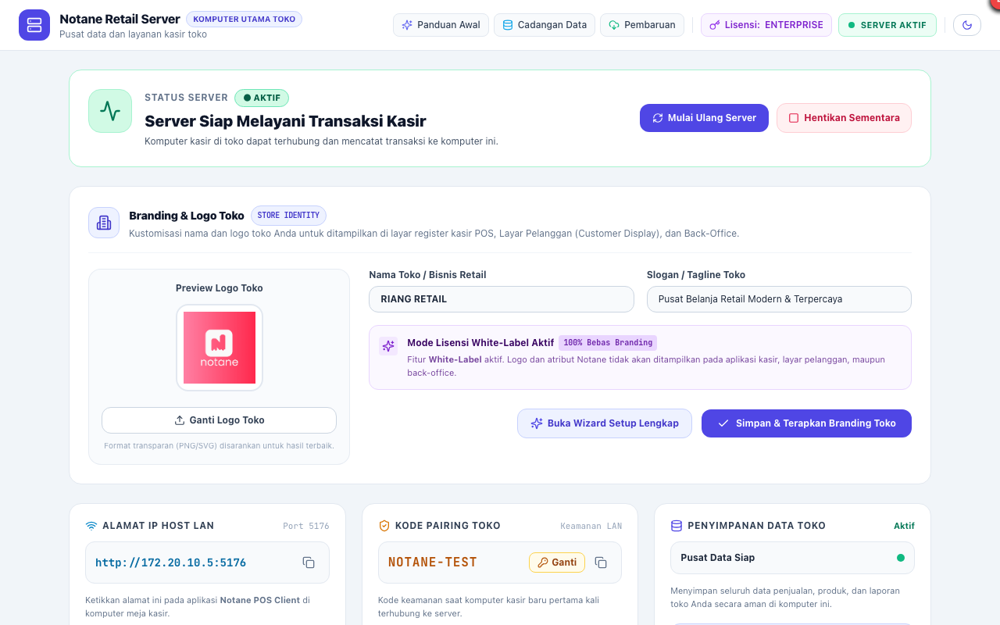
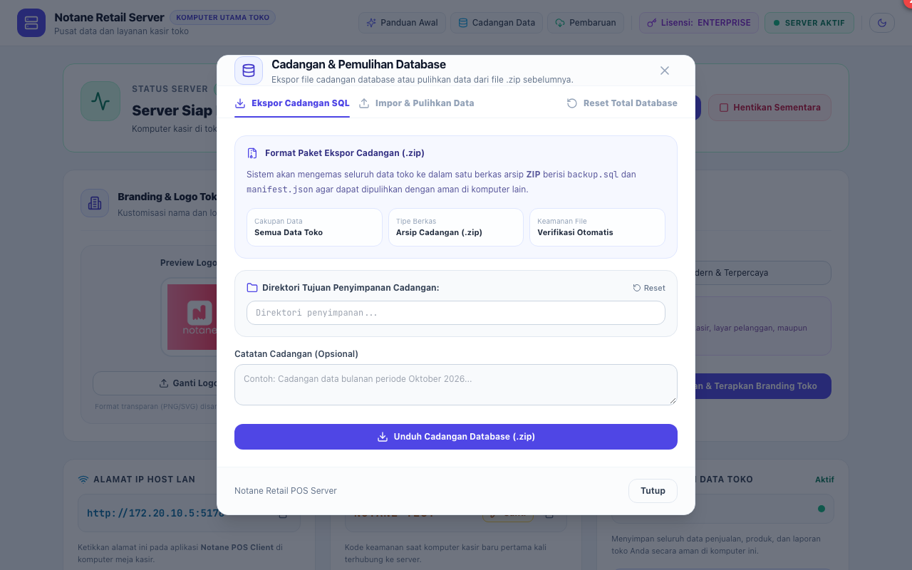
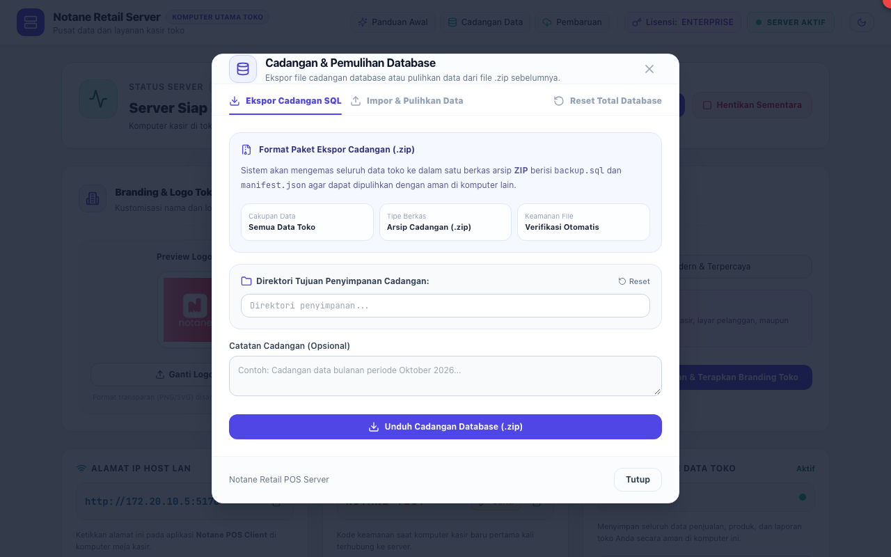

# BAB 0: PANDUAN PENGGUNAAN NOTANE RETAIL SERVER
**Pusat Komando & Basis Data Toko Terpadu**

Notane Retail Server adalah aplikasi induk yang bertindak sebagai pusat penyimpanan basis data (*Database Engine*) dan jembatan sinkronisasi data antar komputer kasir meja depan (*Front-Desk POS*) dan kantor pengelola (*Back-Office*).

---

## 1. ANTARMUKA UTAMA & STATUS SERVER

Aplikasi Server berjalan di komputer utama toko (dapat berupa PC Server dedicated atau PC Kasir 1).

### Elemen Antarmuka yang Ditandai:
1. **[1] Tombol Mulai Ulang Server (`Restart`):**
   - Digunakan untuk memuat ulang mesin server dan koneksi database jika terjadi kendala jaringan lokal.
2. **[2] Tombol Hentikan Sementara (`Stop/Pause`):**
   - Menghentikan penerimaan transaksi baru dari kasir sementara waktu saat hendak melakukan pemeliharaan perangkat keras.
3. **[3] Tombol Cadangan Data (`Database Backup`):**
   - Membuka modal cadangan data untuk mengekspor seluruh rekaman transaksi ke berkas terkompresi ZIP.
4. **[4] Tombol Pembaruan (`System Updates`):**
   - Memeriksa ketersediaan versi terbaru Notane Server dari portal penyedia lisensi resmi.

---

## 2. PENCADANGAN & PEMULIHAN DATA (BACKUP & RESTORE)

Pencadangan rutin wajib dilakukan setiap hari sebelum toko tutup guna mencegah kehilangan data akibat kerusakan listrik atau perangkat keras.

### Prosedur Pencadangan Data:
1. Klik tombol **Cadangan Data** pada bilah navigasi atas.
2. Klik tombol **[1] "Buat Cadangan Baru"**. Sistem akan otomatis menghasilkan file cadangan terenkripsi berformat `.zip` yang berisi dump SQL dan manifest versi.
3. Simpan file cadangan tersebut ke flashdisk atau media penyimpanan eksternal.

### Prosedur Pemulihan Data (*Disaster Recovery*):
1. Jika terjadi penggantian komputer atau kerusakan basis data, klik **[2] "Unggah Cadangan"**.
2. Pilih file `.zip` cadangan yang valid.
3. Sistem akan memvalidasi kesesuaian manifest skema dan memulihkan seluruh rekaman transaksi secara utuh.

---

## 3. PENGATURAN KODE PAIRING KEAMANAN (PAIRING CODE)

Kode Pairing adalah lapisan keamanan Zero-Trust yang mencegah perangkat asing tidak sah terhubung ke basis data toko Anda melalui jaringan Wi-Fi/LAN.

### Langkah Mengubah Kode Pairing:
1. Pada kartu **Kode Pairing Toko**, klik tombol **Ganti**.
2. Masukkan kombinasi kode baru pada kolom **[1] Kode Pairing Baru** (misal: `TOKO-MAJU-2026`).
3. Klik tombol **[2] "Simpan"** untuk menerapkan kode keamanan baru.
4. Masukkan kode ini saat pertama kali menghubungkan komputer kasir Notane Client.

---

## 4. PERSONALISASI BRANDING & NAMA TOKO

Notane Retail mendukung *White-Label Branding* sehingga struk belanja dan tampilan layar menampilkan identitas resmi bisnis retail Anda.

### Langkah Mengatur Identitas Toko:
1. Masukkan nama toko pada kolom **[1] Nama Toko / Bisnis Retail**.
2. Masukkan slogan pada kolom **Slogan / Tagline Toko** (misal: *Pusat Belanja Keluarga Hemat & Lengkap*).
3. Unggah file logo transparan (`.png` / `.svg`) melalui tombol **Ganti Logo Toko**.
4. Klik tombol **[2] "Simpan & Terapkan Branding Toko"**. Seluruh layar kasir dan cetakan struk akan otomatis diperbarui.

---

## 5. PEMBARUAN SISTEM RESMI (OTA UPDATES)

Notane Server dilengkapi dengan fitur pembaruan satu klik (*One-Click Update*) yang terhubung langsung ke portal resmi `https://lisensi.notane.id`.

### Prosedur Memperbarui Server:
1. Klik menu **Pembaruan** di bilah atas.
2. Klik tombol **[1] "Periksa Pembaruan"**.
3. Jika tersedia versi baru, klik tombol **"Pasang Pembaruan"**.
4. Server akan otomatis mengunduh biner baru, melakukan pencadangan otomatis biner lama (`.old`), menukar file biner, dan memuat ulang proses secara aman tanpa kehilangan data transaksi.

