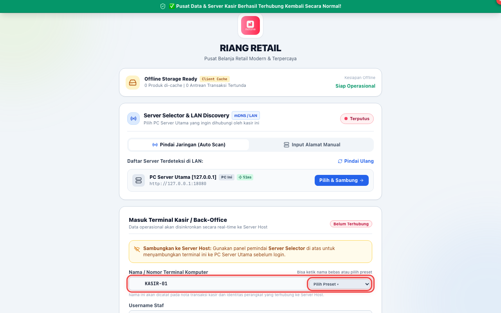
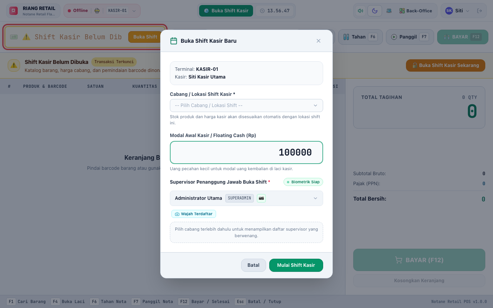
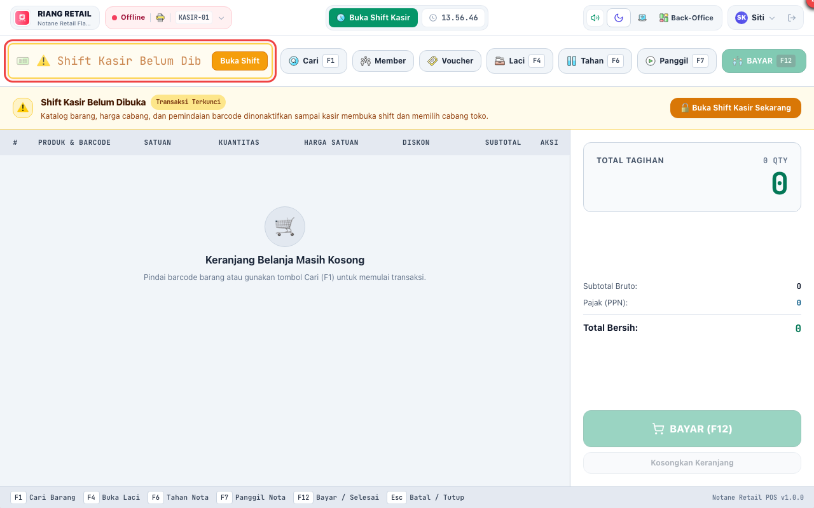
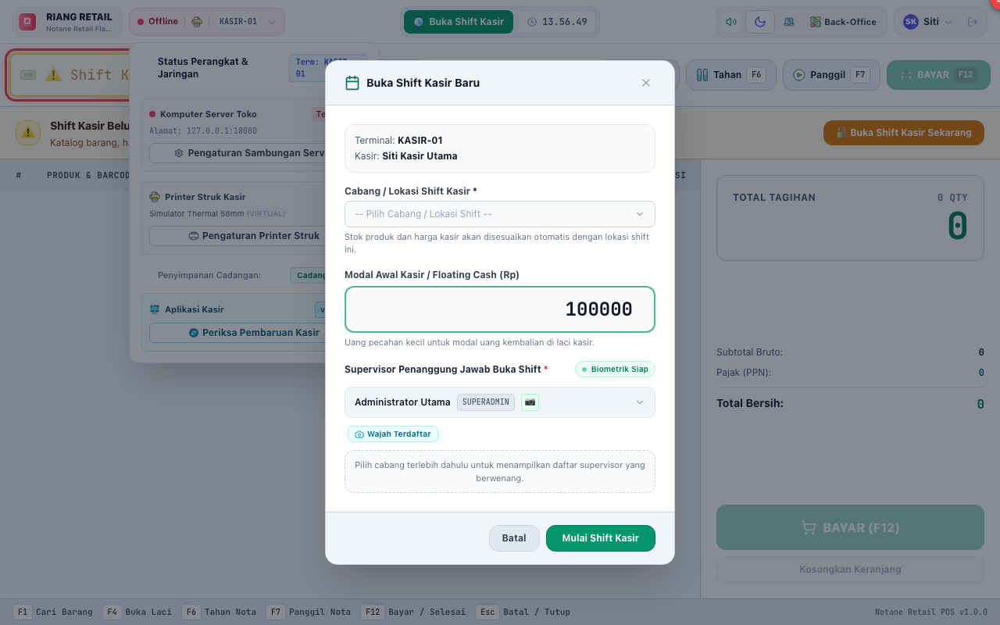

# BAB 1: PANDUAN PENGGUNAAN PERAN KASIR (CASHIER)
**Front-Desk Point of Sale Operations**

Peran **CASHIER** berfokus pada kecepatan, akurasi, dan keramahan pelayanan transaksi penjualan belanja konsumen di meja kasir.

---

## 1. MASUK KE APLIKASI KASIR (LOGIN)

Setiap kasir wajib login menggunakan akun pribadinya sendiri demi akuntabilitas kas laci dan jejak audit nota.

### Langkah-langkah Login:
1. Pastikan kolom **[1] Nama / Nomor Terminal Komputer** terisi sesuai meja kasir Anda (misal: `KASIR-01`).
2. Masukkan username kasir pada kolom **[2] Username Staf** (contoh: `kasir1`).
3. Masukkan password kasir pada kolom **[3] Kata Sandi Login**.
4. Klik tombol **[4] "Masuk"** (atau tekan tombol `Enter` pada keyboard).

---

## 2. MEMBUKA SHIFT KASIR (OPEN SHIFT)

Sebelum dapat melayani pelanggan, sistem kasir mewajibkan pembukaan shift untuk mencatat modal kas awal di laci kasir (*Cash Drawer*).

### Langkah Membuka Shift:
1. Klik tombol **"Buka Shift Kasir"** pada bagian atas layar kasir.
2. Hitung uang fisik modal receh di laci kasir, lalu ketikkan nominalnya pada kolom **[1] Kas Modal Awal** (contoh: `Rp 200.000`).
3. Klik tombol **[2] "Buka Shift Kasir Sekarang"**.
4. Status kasir akan berubah menjadi **Shift Aktif** dan pemindai barcode siap digunakan.

---

## 3. LAYAR UTAMA KASIR POS & PEMINDAIAN BARCODE

Layar kasir didesain ergonomis untuk mendukung pemindaian barcode dengan barcode scanner USB/Bluetooth maupun pencarian nama produk secara cepat.

### Elemen Kerja Kasir:
1. **[1] Kolom Pencarian & Pemindaian Barcode (`F1`):**
   - Arahkan barcode scanner ke kemasan produk atau ketik nama produk langsung di kolom ini.
   - Tekan `Enter` untuk memasukkan produk ke daftar belanja.
2. **[2] Tombol Bayar / Checkout (`F12`):**
   - Membuka jendela pembayaran ketika seluruh belanjaan pelanggan selesai dipindai.
3. **[3] Tombol Tahan Nota (`F6`):**
   - Menahan transaksi belanja pelanggan saat ini jika pelanggan ingin mengambil barang tambahan, sehingga kasir dapat melayani pelanggan berikutnya tanpa membatalkan transaksi.
4. **[4] Tombol Panggil Nota (`F7`):**
   - Membuka kembali daftar nota belanja tertunda yang sebelumnya ditahan.

---

## 4. PEMBAYARAN & PENYELESAIAN TRANSAKSI (CHECKOUT)

Notane Retail mendukung multi-metode pembayaran modern: Tunai, QRIS Dinamis, dan Kartu Debit/Kredit EDC.

### Prosedur Pembayaran:
1. Tekan tombol **`F12`** atau klik tombol **"Bayar"**.
2. Pilih metode pembayaran:
   - **[1] Tunai (Cash):** Pilih tombol pecahan cepat (misal `Rp 50.000`, `Rp 100.000`, `Uang Pas`) atau ketikkan nominal uang yang diterima dari konsumen. Sistem akan otomatis menghitung uang kembalian.
   - **[2] QRIS:** Layar akan menampilkan QR Code pembayaran dinamis untuk dipindai oleh dompet digital konsumen (GoPay, OVO, Dana, BCA, Livin, dll.).
   - **[3] EDC (Kartu Debit/Kredit):** Masukkan nomor referensi mesin EDC bank.
3. Klik tombol **[4] "Selesaikan Pembayaran"**.
4. Laci kasir (*cash drawer*) akan otomatis terbuka dan printer thermal akan mencetak struk belanja resmi.

---

## 5. PENUTUPAN SHIFT & REKONSILIASI KAS (BLIND SETTLEMENT)

Di akhir jam kerja kasir, kasir wajib melakukan penutupan shift (*End of Shift Settlement*).

### Langkah Menutup Shift:
1. Klik tombol **"Tutup Shift"** di pojok kanan atas layar.
2. **Prinsip *Blind Settlement*:** Hitung seluruh uang tunai fisik yang ada di dalam laci kasir tanpa melihat total rekapan sistem terlebih dahulu (mencegah manipulasi kas).
3. Masukkan total uang tunai fisik yang dihitung pada kolom **Uang Fisik Kas Laci**.
4. Masukkan catatan kas jika terdapat selisih uang receh.
5. Klik **"Tutup Shift & Cetak Ringkasan"**.
6. Struk ringkasan shift kasir akan dicetak untuk diserahkan bersama uang tunai ke Supervisor toko.
