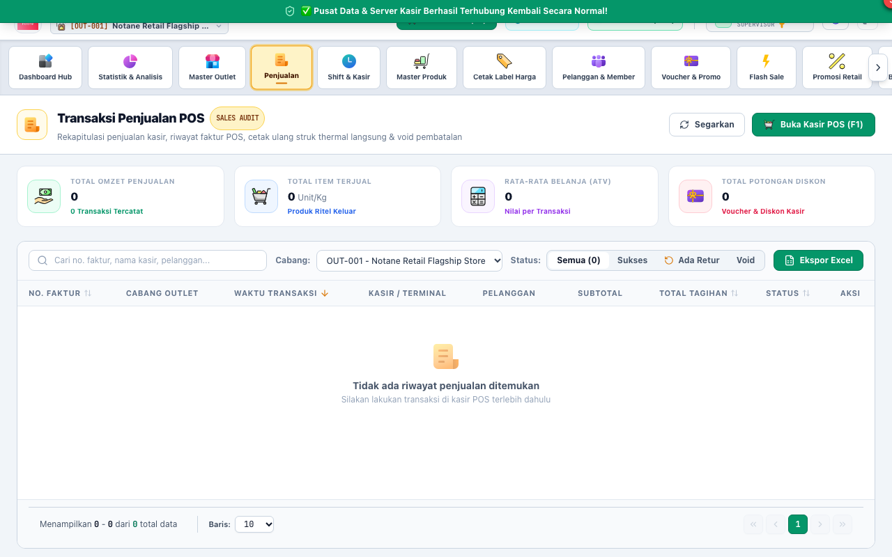
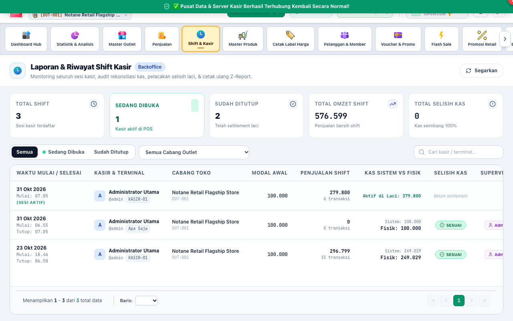

# BAB 2: PANDUAN PENGGUNAAN PERAN SUPERVISOR
**Floor Management, Authorization & Loss Prevention**

Peran **SUPERVISOR** bertindak sebagai komandan lantai gerai yang bertanggung jawab atas otorisasi kasir (Void, Diskon, Buka Laci), pengawasan kas laci, approval retur penjualan, dan penyesuaian stok harian.

---

## 1. DASBOR PENGAWASAN OPERASIONAL SUPERVISOR

Supervisor memiliki hak akses ke menu kasir POS sekaligus Dasbor Back-Office untuk memantau performa gerai secara langsung.

### Menu Utama Pengawasan:
1. **[1] Menu Penjualan:** Memantau daftar nota kasir real-time, status transaksi lunas, dan transaksi yang dibatalkan (*void*).
2. **[2] Menu Stok:** Mengakses kartu persediaan barang, opname gerai, dan penerimaan mutasi stok.
3. **[3] Menu Shift & Kasir:** Memeriksa status kasir yang sedang bertugas, selisih kas laci, dan riwayat setoran uang.

---

## 2. OTORISASI PEMBATALAN NOTA KASIR (VOID AUTHORIZATION)

Sesuai standar ritel modern, kasir dilarang membatalkan nota atau menghapus item tanpa persetujuan Supervisor guna mencegah pencurian (*theft*) atau kecurangan kasir.

### Alur Otorisasi Void:
1. Ketika kasir menekan tombol **"Void Nota"** atau menghapus barang yang sudah tersimpan, layar kasir akan memunculkan dialog **"Otorisasi Supervisor Dibutuhkan"**.
2. Supervisor mendatangi meja kasir yang bersangkutan.
3. Supervisor memeriksa fisik barang yang batal dibeli.
4. Supervisor memilih **Alasan Resmi Pembatalan** dari daftar *Reason Codes* (misal: *Pelanggan Kurang Uang*, *Salah Pindai Barcode*, *Barang Rusak/Cacat*).
5. Supervisor memasukkan **PIN 6-Digit** pribadinya atau menempelkan sidik jari pada pemindai biometrik.
6. Transaksi resmi dibatalkan (*VOID*), laci kasir mencatat log pembatalan, dan sistem akuntansi secara otomatis menerbitkan **Jurnal Pembalik (Reversing Entry)**.

---

## 3. PERSETUJUAN RETUR PENJUALAN KONSUMEN (SALES RETURNS)

Retur barang dari konsumen membutuhkan verifikasi kondisi fisik barang sebelum pengembalian dana (*refund*) atau penukaran barang disetujui.

### Langkah Approval Retur:
1. Buka menu **Penjualan** -> Tab **[1] Retur Penjualan**.
2. Pilih nomor permohonan retur yang diajukan oleh kasir, lalu klik **[2] "Detail Retur"**.
3. Periksa kesesuaian fisik barang yang diretur:
   - Jika kondisi barang masih utuh dan layak jual: Klik **"Setujui Retur & Kembalikan ke Stok Baik"**.
   - Jika barang rusak/kedaluwarsa: Klik **"Setujui Retur & Alokasikan ke Barang Rusak/Waste"**.
   - Jika klaim tidak valid (nota palsu/barang bukan dari toko): Klik **"Tolak Retur"**.
4. Masukkan PIN Supervisor untuk mengesahkan permohonan retur.

---

## 4. PENARIKAN KAS LACI KASIR (CASH DROP)

Untuk keamanan toko dan membatasi risiko kerugian bila terjadi perampokan, uang tunai di laci kasir tidak boleh menumpuk melebihi ambang batas (misal: maksimal Rp 1.500.000).

### Prosedur Cash Drop:
1. Masuk ke menu **Shift & Kasir** -> klik **[1] "Setor Kas Laci (Cash Drop)"**.
2. Pilih nomor meja kasir (contoh: `KASIR-01`).
3. Masukkan nominal uang yang ditarik dari kasir untuk dipindahkan ke brankas toko (contoh: `Rp 2.000.000`).
4. Supervisor dan kasir menandatangani bukti serah terima kas.
5. Klik **"Simpan Serah Terima Kas"**. Saldo kas di laci kasir otomatis berkurang dan tercatat di buku kas brankas.

---

## 5. PENYESUAIAN STOK OPNAME HARIAN (STOCK ADJUSTMENT)

Supervisor memimpin pelaksanaan *cycle count* (stock opname harian untuk barang rawan hilang seperti rokok, susu, dan kosmetik).

### Langkah Penyesuaian Stok:
1. Buka menu **Stok & Opname**.
2. Cari produk yang dihitung fisiknya.
3. Klik tombol **"Penyesuaian Stok"**.
4. Masukkan jumlah fisik aktual yang ada di rak toko.
5. Pilih alasan selisih (misal: *Barang Hilang/Shrinkage*, *Selisih Hitung Awal*, *Barang Pecah/Bocor*).
6. Klik **"Terapkan Penyesuaian"**. Sistem akan mengoreksi saldo persediaan dan membukukan beban selisih opname secara otomatis.

