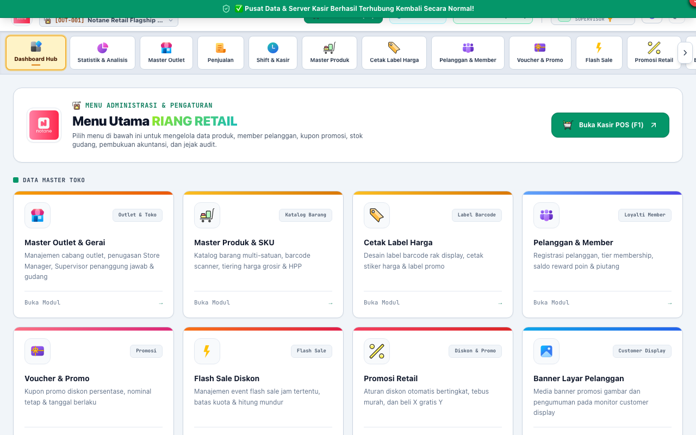
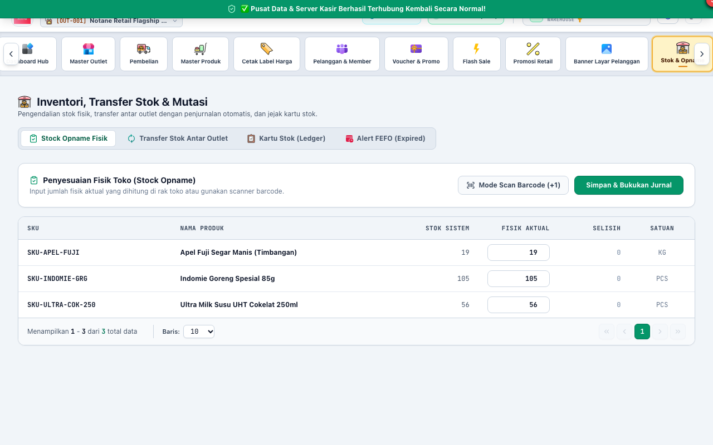
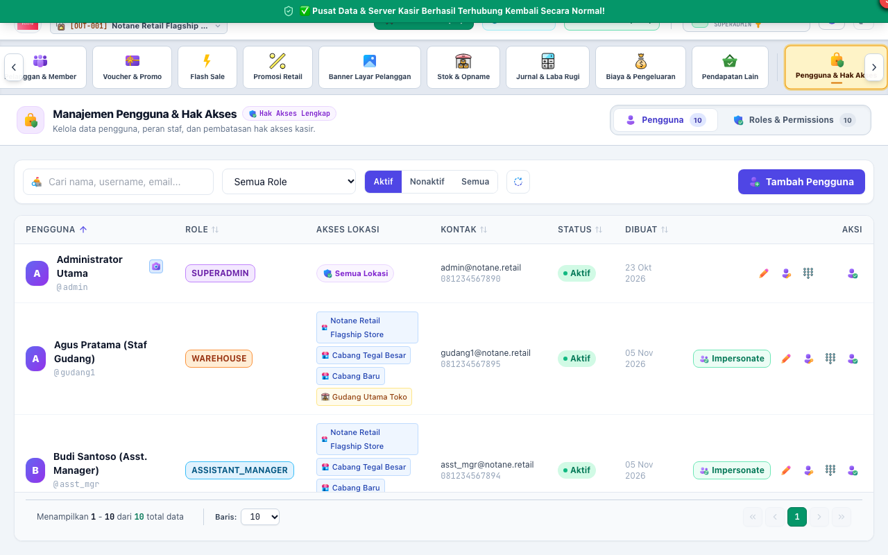

# BAB 3: PANDUAN PENGGUNAAN ASISTEN MANAJER TOKO (ASSISTANT_MANAGER)
**Store Operations & Daily Management**

Peran **ASSISTANT_MANAGER** (Asisten Kepala Toko / Deputy Store Manager) bertindak sebagai wakil pimpinan gerai yang memegang kendali operasional harian, mengawasi kasir dan supervisor, menangani penerimaan barang masuk (*Goods Receipt Note*), serta membantu penanganan kendala staf.

---

## 1. PENGAWASAN OPERASIONAL GERAI

Asisten Manajer memiliki akses operasional harian yang setara dengan Store Manager, namun dibatasi dari penutupan buku permanen akuntansi (*Hard-Close*) atau konfigurasi sistem inti.

### Tugas Harian Asisten Manajer:
1. Memastikan seluruh kasir telah membuka shift kasir dan modal kas laci tercatat dengan benar.
2. Memeriksa ketersediaan uang pecahan kecil di brankas toko untuk kebutuhan uang kembalian meja kasir.
3. Memantau grafik penjualan harian dan ketercapaian target gerai (*daily sales target*).

---

## 2. PENERIMAAN BARANG MASUK DARI SUPPLIER (GOODS RECEIPT NOTE)

Ketika truk pengiriman barang dari pemasok atau Distribution Center (DC) tiba di toko, Asisten Manajer bertanggung jawab memverifikasi fisik barang.

### Prosedur Penerimaan Barang (GRN):
1. Masuk ke menu **Pembelian** -> klik **"Penerimaan Barang (GRN)"**.
2. Pilih nomor Pesanan Pembelian (**Purchase Order / PO**) yang sesuai dengan surat jalan supir vendor.
3. Cocokkan fisik barang:
   - Hitung jumlah karton dan satuan pieces.
   - Periksa tanggal kedaluwarsa (*Expired Date*): pastikan sisa masa simpan memenuhi ketentuan toko (minimal 6 bulan - 1 tahun).
   - Periksa kondisi fisik kemasan (tidak penyok, sobek, atau bocor).
4. Masukkan jumlah kuantitas aktual yang diterima. Jika terdapat barang yang rusak/kurang, catat sebagai barang retur/tolakan faktur.
5. Klik **"Simpan & Masukkan ke Stok Toko"**. Stok sistem akan langsung bertambah dan kartu stok mencatat nomor dokumen penerimaan.

---

## 3. TRANSFER STOK ANTAR CABANG GERAI

Jika cabang toko Anda kehabisan stok barang tertentu sedangkan cabang terdekat memiliki kelebihan stok, Asisten Manajer dapat mengoordinasikan transfer stok.

### Prosedur Penerimaan Transfer Stok:
1. Masuk ke menu **Stok & Opname** -> Tab **Transfer Stok**.
2. Cari dokumen transfer masuk dengan status *In-Transit* (sedang dalam perjalanan).
3. Setelah kurir antar-toko menyerahkan fisik barang, lakukan penghitungan fisik.
4. Klik tombol **"Konfirmasi Penerimaan Transfer"**.
5. Stok barang di gerai Anda akan otomatis aktif dan siap dijual di meja kasir.

---

## 4. MANAJEMEN STAF: RESET PIN KASIR & SUPERVISOR

Kasir atau supervisor yang lupa nomor PIN otorisasi transaksi dapat meminta bantuan Asisten Manajer untuk melakukan reset PIN tanpa harus login ke akun Superadmin.

### Langkah Reset PIN Staf:
1. Buka menu **Pengguna & Hak Akses**.
2. Cari nama kasir atau staf yang bersangkutan di daftar staf.
3. Klik ikon gembok / **"Ganti PIN"**.
4. Masukkan nomor PIN baru (6-digit angka).
5. Konfirmasi PIN baru, lalu klik **"Simpan PIN Baru"**. Staf dapat langsung menggunakan PIN baru tersebut untuk otorisasi di kasir.
