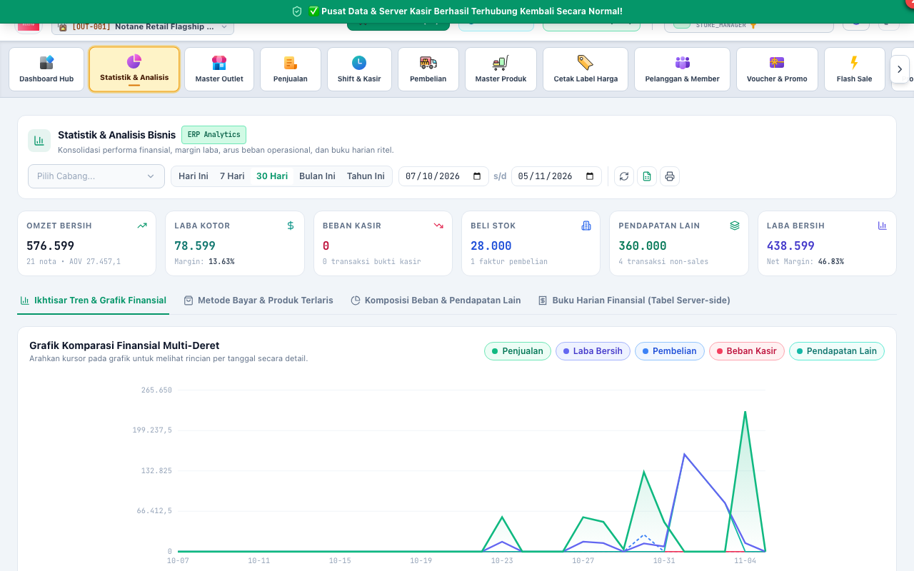
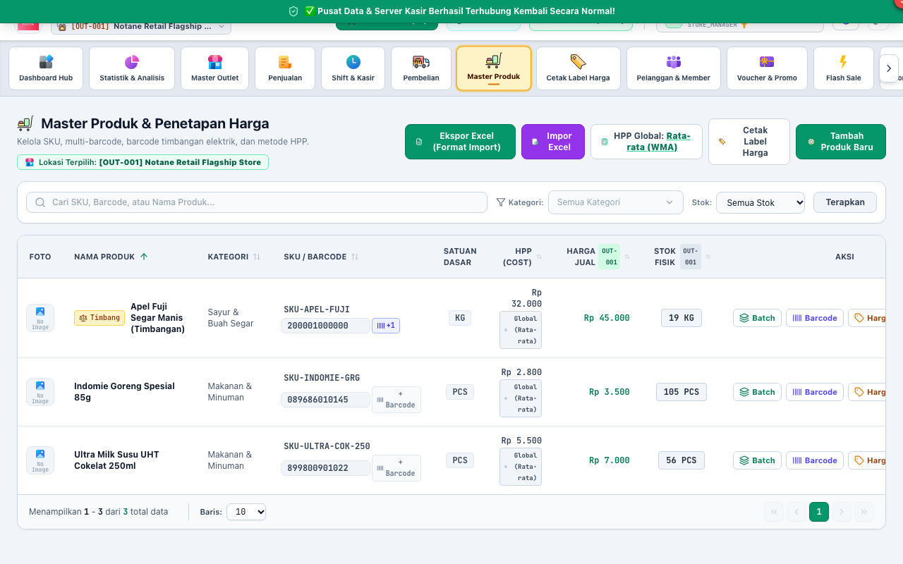
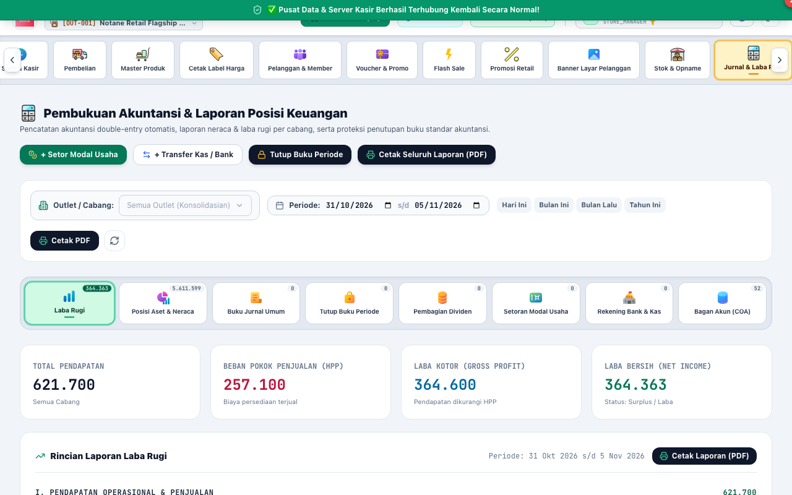

# BAB 4: PANDUAN PENGGUNAAN KEPALA TOKO (STORE_MANAGER)
**Store Executive Leadership, Strategy & Accounting Closing**

Peran **STORE_MANAGER** (Kepala Toko / General Store Manager) memegang otoritas operasional tertinggi di gerai, bertanggung jawab atas pencapaian laba gerai, strategi harga jual cabang, analisis performa bisnis, dan penutupan buku periode akuntansi.

---

## 1. DASBOR EKSEKUTIF & ANALITIK BISNIS TOKO

Kepala Toko menggunakan Dasbor Analitik Bisnis untuk memantau performa finansial dan operasional gerai secara terintegrasi.

### Metrik Kinerja Utama yang Ditandai:
1. **[1] Omzet Bersih & Rata-rata Nilai Nota (AOV - Average Order Value):**
   - Menunjukkan total nilai transaksi bersih setelah potongan diskon dan retur.
2. **[2] Laba Kotor (*Gross Profit*) & Margin (%):**
   - Menghitung keuntungan bersih dari penjualan dikurangi Beban Pokok Penjualan (HPP modal barang).
3. **[3] Filter Rentang Tanggal & Outlet:**
   - Menyaring data performa berdasarkan tanggal hari ini, 7 hari terakhir, 30 hari, bulanan, atau tahunan untuk evaluasi berkala.

---

## 2. MANAJEMEN MULTI-HARGA OUTLET & GROSIR BERTINGKAT

Notane Retail mendukung fleksibilitas penentuan harga jual per outlet cabang gerai (misal: gerai bandara atau mall memiliki harga berbeda dengan gerai pinggir jalan).

### Langkah Menentukan Harga Khusus Gerai:
1. Buka menu **Master Produk**.
2. Cari produk yang ingin diubah harganya, lalu klik ikon **[2] "Harga Khusus Outlet"**.
3. Pilih cabang outlet yang dikelola.
4. Masukkan harga jual spesifik untuk gerai tersebut.
5. Anda juga dapat menentukan **Harga Khusus Member VIP** atau **Harga Grosir Bertingkat (Price Tiers)** berdasarkan kuantitas beli (misal: beli 1 = Rp 10.000, beli >= 10 = Rp 9.200).
6. Klik **"Simpan Perubahan Harga"**.

---

## 3. PENUTUPAN BUKU PERIODE AKUNTANSI TOKO (SOFT-CLOSE)

Untuk mencegah kecurangan transaksi bertanggal lampau (*backdating transactions*) dan menjaga integritas laporan keuangan bulanan, Kepala Toko wajib melakukan tutup buku periode.

### Prosedur Penutupan Buku (*Soft-Close*):
1. Buka menu **Jurnal & Laba Rugi** -> Tab **[1] "Tutup Buku Periode"**.
2. Pastikan seluruh transaksi kasir, pelunasan utang supplier, dan pencatatan biaya operasional pada bulan berjalan sudah tuntas.
3. Klik tombol **"Tutup Periode Akuntansi (Soft-Close)"**.
4. Sistem akan mengunci tanggal transaksi dalam periode tersebut. Tidak ada staf yang dapat mengubah, menghapus, atau menambahkan transaksi baru pada tanggal yang telah ditutup.
5. Laporan laba rugi dan neraca saldo periode tersebut dinyatakan final dan siap dilaporkan ke kantor pusat.

---

## 4. PENGAWASAN BIAYA OPERASIONAL GERAI (EXPENSES CONTROL)

Kepala Toko berhak menyetujui atau menolak pengeluaran operasional toko (misal: pembelian ATK kasir, bensin operasional, tagihan listrik, air, dan konsumsi lembur staf).

### Langkah Otorisasi Biaya:
1. Masuk ke menu **Biaya & Pengeluaran**.
2. Periksa nota bukti pengeluaran yang diinput oleh staf.
3. Pastikan nominal dan kategori pos pengeluaran sesuai anggaran gerai.
4. Setujui atau batalkan transaksi beban kas yang tidak sesuai prosedur.
