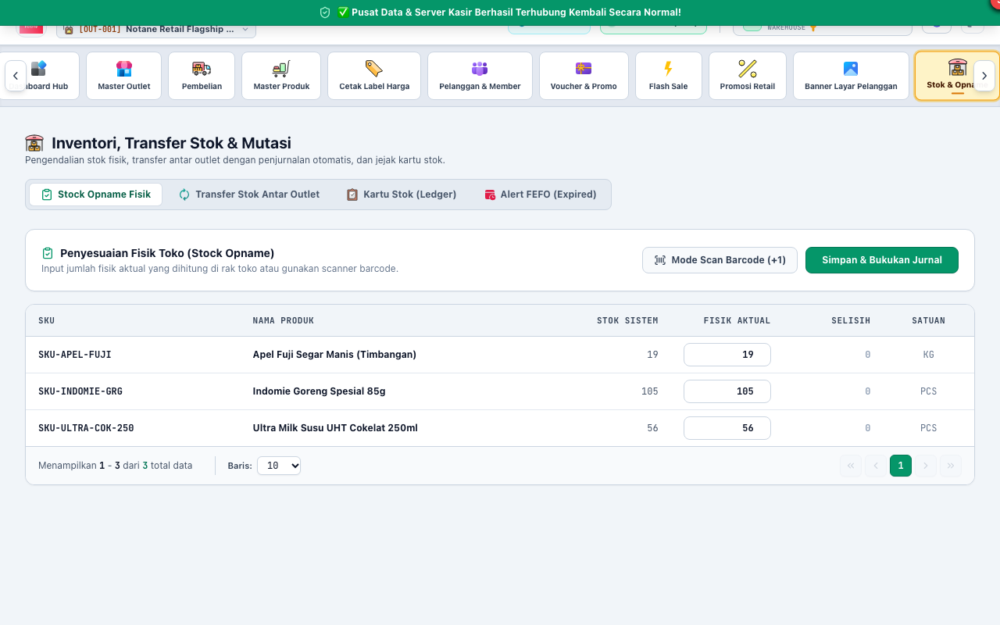
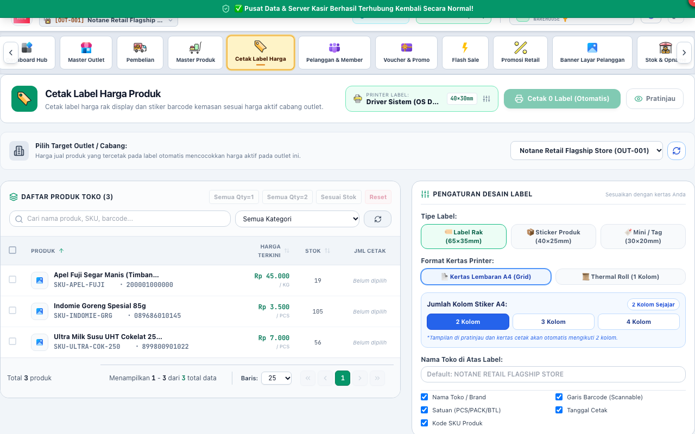

# BAB 5: PANDUAN PENGGUNAAN STAF GUDANG & LOGISTIK (WAREHOUSE)
**Inventory Control, Logistics & Barcode Management**

Peran **WAREHOUSE** bertanggung jawab penuh atas akurasi fisik stok barang, penerimaan barang supplier, mutasi transfer antar outlet, pengendalian tanggal kedaluwarsa (FEFO), dan pencetakan label barcode rak toko.

---

## 1. PEMANTAUAN STOK & KARTU MUTASI BARANG

Staf Gudang memantau ketersediaan barang di gudang utama maupun rak pajang toko melalui menu Stok & Inventori.

### Fitur Utama Gudang yang Ditandai:
1. **[1] Tombol Transfer Stok:** Membuat dokumen pengiriman barang antar cabang gerai toko.
2. **[2] Tombol Penyesuaian Stok (Opname):** Mengoreksi selisih stok fisik hasil penghitungan berkala.
3. **[3] Kartu Stok Detail:** Menelusuri seluruh riwayat masuk dan keluarnya barang per nota transaksi penjualan, pembelian, atau transfer.

---

## 2. MUTASI & PENGIRIMAN TRANSFER STOK CABANG

Ketika cabang lain membutuhkan pasokan stok dari gudang Anda:

### Langkah Mengirim Transfer Stok:
1. Klik tombol **"Transfer Stok"** -> **"Buat Pengiriman Transfer"**.
2. Pilih **Outlet Asal** (gudang Anda) dan **Outlet Tujuan** (cabang penerima).
3. Pilih produk dan masukkan jumlah kuantitas yang dikirim.
4. Klik **"Kirim Transfer Barang"**.
5. Status barang akan berubah menjadi **In-Transit**. Stok di gudang asal langsung berkurang, dan barang dalam perjalanan dicatat di akun perantara persediaan transit.
6. Cetak Surat Jalan Pengiriman untuk dibawa oleh sopir/kurir pengantar.

---

## 3. PENGENDALIAN KEDALUWARSA & BATCH STOK (FEFO TRACKING)

Notane Retail menerapkan prinsip **FEFO (First Expired, First Out)** di mana stok dengan tanggal kedaluwarsa paling dekat harus dikeluarkan atau dipajang terlebih dahulu di rak depan.

### Pemantauan Batch Kedaluwarsa:
1. Masuk ke menu **Master Produk** -> pilih produk segar / makanan / farmasi.
2. Klik tab **"Batch & Kedaluwarsa"**.
3. Sistem akan mengelompokkan stok per nomor batch pengiriman dan tanggal *Expired Date*.
4. Sistem memberi penanda visual warna merah untuk batch yang mendekati 30-60 hari sebelum kedaluwarsa agar segera dipromosikan (misal dibuatkan program Flash Sale atau Diskon Khusus).

---

## 4. PENCETAKAN LABEL BARCODE RAK TOKO (SHELF LABELS)

Untuk memudahkan pelanggan melihat harga dan kasir memindai barcode, staf gudang bertugas mencetak label harga rak.

### Langkah Mencetak Label Barcode:
1. Masuk ke menu **Cetak Label Harga**.
2. Pilih produk-produk yang baru masuk atau baru mengalami perubahan harga jual.
3. Tentukan jumlah lembar label yang ingin dicetak per item.
4. Pilih **[2] Format Kertas Label** (misal: kertas stiker thermal 3-kolom, label barcode tunggal, atau label harga rak mini).
5. Klik tombol **[1] "Cetak Label"**. Tempelkan label harga pada rak pajang barang di toko.
