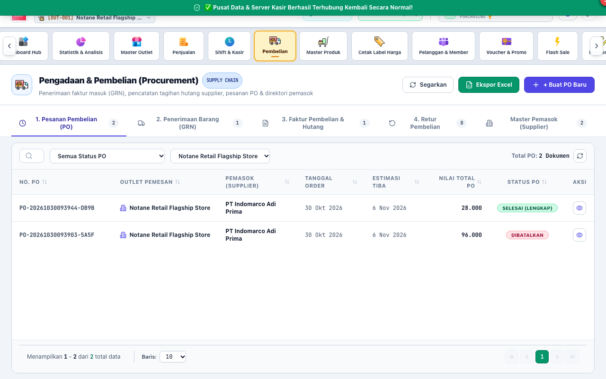

# BAB 6: PANDUAN PENGGUNAAN PENGADAAN & PEMBELIAN (PURCHASING)
**Procurement, Vendor Relations & Accounts Payable**

Peran **PURCHASING** (Staf Pengadaan / Buyer) bertanggung jawab atas perencanaan pesanan pembelian barang ke vendor, verifikasi faktur pembelian, pemantauan batas kredit pemasok, dan pelunasan utang dagang toko.

---

## 1. PEMBUATAN PESANAN PEMBELIAN (PURCHASE ORDER / PO)

Pesanan Pembelian resmi (PO) diterbitkan untuk mengunci harga beli barang dan syarat pembayaran dari pemasok sebelum barang dikirim.

### Elemen Utama Menu Pembelian:
1. **[1] Tombol Buat Pesanan (PO Baru):** Membuka formulir pembuatan pesanan barang ke supplier.
2. **[2] Tab Bukti Penerimaan Barang (GRN):** Melihat riwayat barang yang sudah tiba di gudang.
3. **[3] Tab Faktur Pembelian (Invoices):** Memeriksa tagihan utang supplier yang telah terbit.

### Langkah Menerbitkan PO:
1. Klik tombol **"Buat Pesanan Pembelian Baru"**.
2. Pilih nama **Pemasok (Supplier)** dari daftar rekanan.
3. Tentukan outlet atau gudang tujuan pengiriman barang.
4. Pilih produk-produk yang ingin dipesan, masukkan kuantitas karton/dus, dan periksa harga beli satuan (HPP).
5. Tentukan syarat termin pembayaran (misal: *Cash on Delivery / COD*, *Net 14 Hari*, *Net 30 Hari*).
6. Klik **"Terbitkan Pesanan Pembelian"**.
7. Cetak dokumen PO atau kirimkan file PDF langsung ke kontak perwakilan vendor.

---

## 2. VERIFIKASI FAKTUR PEMBELIAN & PPN MASUKAN

Setelah barang diterima oleh bagian gudang (GRN selesai), Purchasing menerbitkan Faktur Pembelian (*Purchase Invoice*).

### Prosedur Penerbitan Faktur Supplier:
1. Pada menu **Pembelian**, klik **"Terbitkan Faktur dari GRN"**.
2. Masukkan nomor faktur resmi dari vendor dan nomor seri faktur pajak (jika ada).
3. Masukkan tanggal jatuh tempo pembayaran (*Due Date*).
4. Masukkan rincian PPN Masukan (11% atau 12%) dan potongan diskon faktur dari supplier.
5. Simpan faktur. Sistem otomatis membukukan penambahan utang dagang (*Accounts Payable*) dan pembaruan harga pokok persediaan.

---

## 3. PELUNASAN UTANG DAGANG SUPPLIER (DEBT SETTLEMENT)

Purchasing memantau jadwal jatuh tempo faktur untuk menjaga reputasi kredit toko di mata rekanan supplier.

### Langkah Pelunasan Utang:
1. Buka tab **Faktur Pembelian** -> filter status **"Belum Lunas"**.
2. Pilih nomor faktur yang jatuh tempo, lalu klik tombol **"Bayar Faktur"**.
3. Pilih rekening sumber dana (misal: *Kas Operasional*, *Rekening Bank BCA Usaha*, atau *Bank Mandiri*).
4. Masukkan nominal pembayaran (bisa lunas penuh atau cicilan parsial).
5. Masukkan nomor bukti transfer perbankan pada kolom catatan.
6. Klik **"Simpan Pembayaran"**. Status faktur berubah menjadi *Lunas*, dan saldo kas/bank berkurang secara otomatis di pembukuan.

---

## 4. RETUR PEMBELIAN KE SUPPLIER (PURCHASE RETURNS)

Jika terdapat barang kiriman supplier yang rusak, kadaluarsa, atau tidak sesuai pesanan:
1. Masuk ke tab **Retur Pembelian** -> klik **"Buat Retur Pembelian"**.
2. Pilih faktur pembelian asal.
3. Masukkan item dan kuantitas barang yang dikembalikan ke supplier.
4. Pilih opsi kompensasi: **Pemotongan Saldo Utang** atau **Pengembalian Uang Tunai/Transfer**.
5. Klik **"Konfirmasi Retur Supplier"**. Stok barang rusak otomatis dikeluarkan dan tagihan utang supplier dikurangi.

