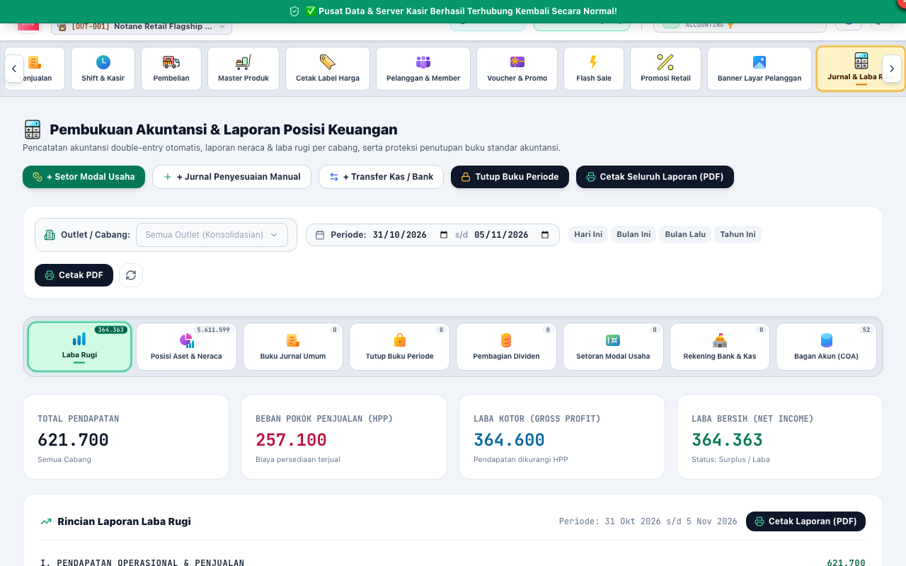
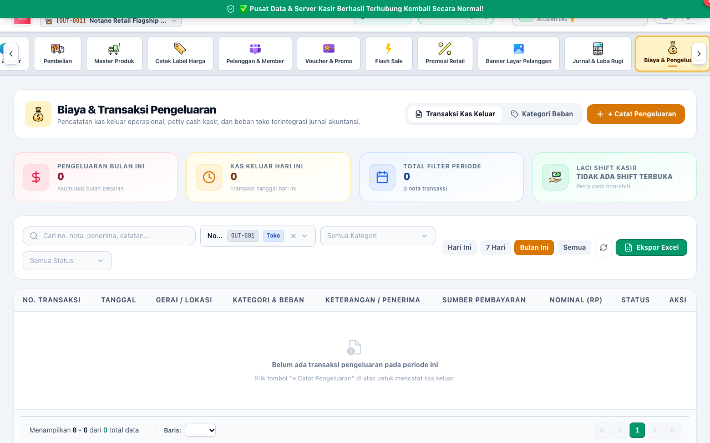

# BAB 7: PANDUAN PENGGUNAAN STAF AKUNTANSI & KEUANGAN (ACCOUNTING)
**General Ledger, Financial Accounting & Cash Management**

Peran **ACCOUNTING** bertanggung jawab atas kepatuhan standar akuntansi keuangan (SAK), integritas pencatatan jurnal umum berpasangan (*Double-Entry Bookkeeping*), rekonsiliasi kas/bank, pencatatan beban operasional, serta penyusunan laporan laba rugi dan neraca.

---

## 1. PEMBUKUAN AKUNTANSI & LAPORAN POSISI KEUANGAN

Notane Retail mengintegrasikan seluruh transaksi operasional kasir dan gudang secara otomatis ke sistem akuntansi umum (*General Ledger*).

### Navigasi Tab Finansial yang Ditandai:
1. **[1] Tab Laba Rugi:** Menampilkan rincian pendapatan penjualan, HPP barang, beban operasional, pendapatan lain, dan laba bersih periode.
2. **[2] Tab Posisi Aset & Neraca:** Menampilkan ringkasan aktiva lancar (kas, bank, piutang, persediaan), aktiva tetap, kewajiban utang dagang, dan ekuitas modal.
3. **[3] Tab Buku Jurnal Umum:** Melihat seluruh jurnal transaksi otomatis dari kasir maupun jurnal penyesuaian manual.
4. **[4] Tab Bagan Akun (COA):** Mengelola struktur hierarki nomor akun akuntansi 4 digit / 5 digit.

---

## 2. PENCATATAN JURNAL PENYESUAIAN MANUAL (MANUAL JOURNAL)

Untuk transaksi yang tidak memiliki modul kasir langsung (misal: penyusutan aktiva tetap, bunga bank, pajak penghasilan, atau amortisasi):

### Langkah Membuat Jurnal Penyesuaian:
1. Klik tombol **"+ Jurnal Penyesuaian Manual"**.
2. Masukkan tanggal transaksi dan uraian keterangan jurnal.
3. Tambahkan baris akun:
   - Pilih Akun Sisi **Debit** dan masukkan nominalnya.
   - Pilih Akun Sisi **Kredit** dan masukkan nominalnya.
4. **Prinsip Keseimbangan Mutlak:** Pastikan total debit sama persis dengan total kredit (`Total Debit == Total Credit`). Sistem akan menolak penyimpanan jika jurnal tidak seimbang (*unbalanced*).
5. Klik **"Posting Jurnal Akuntansi"**.

---

## 3. PENCATATAN BIAYA & BEBAN OPERASIONAL (EXPENSES)

Pengeluaran kas harian toko dicatat melalui modul biaya operasional dengan pengelompokan pos beban yang rapi.

### Prosedur Pencatatan Beban:
1. Masuk ke menu **Biaya & Pengeluaran** -> klik tombol **[1] "Tambah Pengeluaran"**.
2. Pilih pos kategori beban pada **[2] Kategori Beban** (misal: *Beban Listrik & Air*, *Beban Gaji & Lembur*, *Beban ATK & Struk Kasir*, *Beban Pemeliharaan AC/Toko*).
3. Pilih rekening kas sumber dana (misal: *Kas Kecil Toko* atau *Bank Operasional*).
4. Masukkan nominal pengeluaran dan catatan rincian nota.
5. Klik **"Simpan Beban Pengeluaran"**. Jurnal umum debit beban operasional dan kredit kas otomatis terbentuk.

---

## 4. PENUTUPAN BUKU PERMANEN AKUNTANSI (HARD-CLOSE)

Pada akhir tahun buku atau setelah pelaksanaan audit eksternal/pajak selesai, staf akuntansi melakukan penutupan buku permanen.

### Prosedur Hard-Close:
1. Buka menu **Jurnal & Laba Rugi** -> Tab **Tutup Buku Periode**.
2. Pilih periode akuntansi yang telah berstatus *Soft-Close*.
3. Klik tombol **"Tutup Permanen (Hard-Close / Audit Final)"**.
4. Periode akan terkunci permanen. Seluruh saldo pendapatan dan beban ditutup ke akun **Ikhtisar Laba Rugi** dan dialokasikan ke **Laba Ditahan (Retained Earnings)**.

