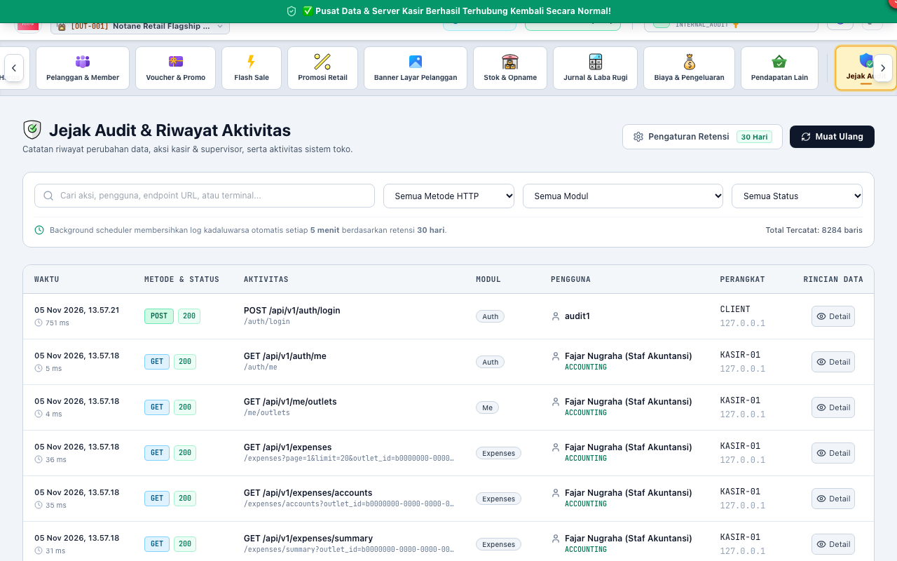

# BAB 8: PANDUAN PENGGUNAAN AUDITOR INTERNAL (INTERNAL_AUDIT)
**Loss Prevention, Compliance & Security Audit**

Peran **INTERNAL_AUDIT** (Pengawas Mutu & Kepatuhan / Loss Prevention) memegang hak akses pemeriksaan (*Read-Only Komprehensif*) ke seluruh transaksi gerai untuk mendeteksi kecurangan (*fraud*), menganalisis selisih persediaan (*shrinkage*), dan memastikan seluruh staf mematuhi SOP retail.

---

## 1. PEMANTAUAN JEJAK AUDIT KEAMANAN (AUDIT LOGS)

Setiap aksi perubahan data sensitif di seluruh sistem (login, hapus produk, void kasir, ubah harga, perubahan hak akses) otomatis terekam dalam log audit yang tidak dapat dimanipulasi (*immutable*).

### Informasi Penting yang Ditandai:
1. **[1] Filter Rentang Waktu & Modul:** Mempersempit penelusuran berdasarkan modul tertentu (misal: `sales`, `users`, `products`, `accounting`).
2. **[2] Rekaman Aktivitas Pengguna:** Menampilkan timestamp presisi, alamat IP terminal, nama staf pelaksana, dan jenis aksi (*CREATE*, *UPDATE*, *VOID*, *DELETE*).
3. **[3] Rincian Data Sebelum & Sesudah:** Membandingkan nilai lama dan nilai baru yang diubah oleh pengguna untuk membuktikan rekayasa data.

---

## 2. AUDIT INVESTIGASI PEMBATALAN NOTA KASIR (VOID AUDIT)

Pembatalan nota kasir (*Void*) merupakan salah satu celah kebocoran pendapatan terbesar di bisnis retail jika tidak diawasi secara ketat.

### Prosedur Investigasi Void Kasir:
1. Masuk ke menu **Penjualan** -> filter status transaksi **"VOID"**.
2. Evaluasi frekuensi nota batal per kasir:
   - Jika satu kasir memiliki rasio nota void di atas batas normal (misal > 3% dari total transaksi), lakukan investigasi mendalam.
3. Periksa akun Supervisor yang mengotorisasi pembatalan tersebut dan alasan resmi dari tabel *Reason Codes*.
4. Cocokkan waktu pembatalan nota dengan rekaman kamera CCTV meja kasir. Pastikan barang benar-benar dikembalikan ke rak dan uang tidak diambil oleh oknum kasir.

---

## 3. AUDIT SELISIH STOK & PENYUSUTAN BARANG (SHRINKAGE ANALYSIS)

Auditor Internal secara berkala membandingkan saldo kartu stok sistem dengan hasil penghitungan fisik di rak toko dan gudang.

### Langkah Audit Persediaan:
1. Buka menu **Stok & Opname** -> periksa riwayat **Penyesuaian Stok (Stock Adjustment)**.
2. Identifikasi produk-produk dengan nilai selisih minus tertinggi (*Top Loss Items*).
3. Analisis apakah selisih disebabkan oleh:
   - Kesalahan pencatatan kasir (salah scan varian produk serupa).
   - Kerusakan fisik barang yang tidak dilaporkan (*damaged/expired*).
   - Pengutilan oleh pembeli (*shoplifting*) atau pencurian internal (*internal theft*).
4. Buat Berita Acara Temuan Audit dan serahkan rekomendasi perbaikan pencegahan kehilangan (*loss prevention*) kepada Kepala Toko dan Manajemen Pusat.

