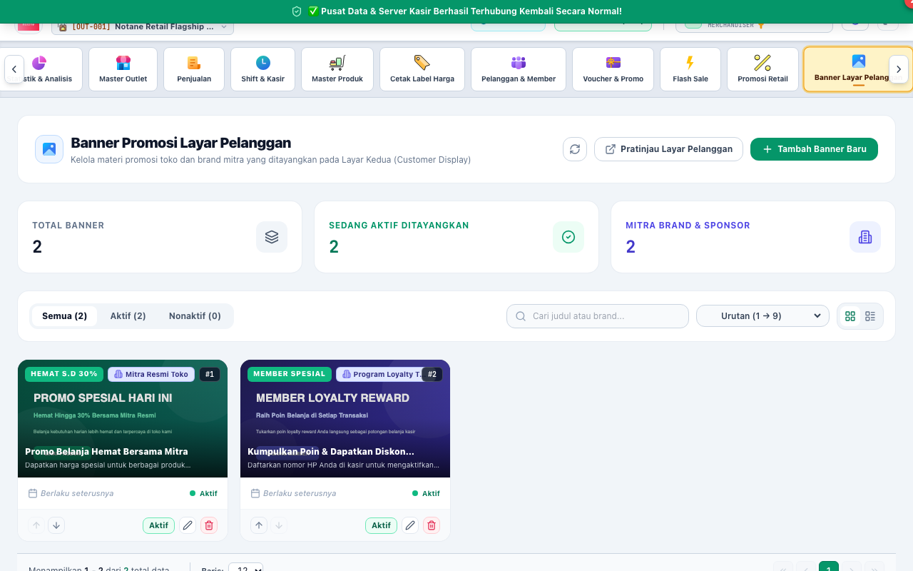
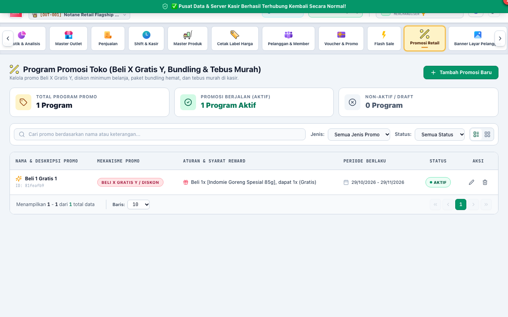

# BAB 9: PANDUAN PENGGUNAAN MERCHANDISER & PROMOSI (MERCHANDISER)
**Catalog Management, Customer Display Banners & Promotions**

Peran **MERCHANDISER** bertanggung jawab atas daya tarik produk di mata konsumen, pengelolaan katalog master produk, penataan spanduk promosi pada layar pelanggan (*Customer Display Screen*), serta pembuatan program promosi diskon, flash sale, dan voucher kupon belanja.

---

## 1. PENGELOLAAN BANNER LAYAR KEDUA (CUSTOMER DISPLAY BANNERS)

Di meja kasir modern, layar kedua yang menghadap ke konsumen (*Customer Facing Display*) dapat menampilkan slide banner gambar promosi saat kasir tidak sedang memindai belanjaan.

### Langkah Mengunggah & Mengatur Banner:
1. Masuk ke menu **Banner Layar Pelanggan** -> klik tombol **[1] "Unggah Banner Baru"**.
2. Pilih file gambar promosi beresolusi tinggi (disarankan rasio 16:9, resolusi 1920x1080 atau 1280x720, format JPG/PNG/WebP).
3. Masukkan judul banner promosi dan atur **[2] Urutan Tampilan (Sort Order)**.
4. Tentukan periode tayang (tanggal mulai dan tanggal selesai promo).
5. Aktifkan saklar status **"Tampilkan di Layar Kasir"**. Layar pelanggan di seluruh terminal kasir gerai akan otomatis memuat dan memutar gambar promosi tersebut secara bergantian (*slideshow carousel*).

---

## 2. MANAJEMEN PROMOSI RETAIL & FLASH SALE

Untuk meningkatkan nilai belanja konsumen (*basket size*), Merchandiser dapat merancang berbagai skenario diskon:

### Jenis Skema Promosi yang Didukung:
1. **[1] Promosi Diskon Persentase / Nominal:**
   - Potongan harga langsung untuk produk tertentu (misal: *Diskon 20%* atau *Potongan Rp 5.000*).
2. **[2] Flash Sale:**
   - Promosi berbatas waktu khusus dengan hitung mundur (*countdown timer*) dan batas kuota maksimal pembelian per transaksi konsumen.
3. **Beli X Dapat Y (*Buy 1 Get 1 / Bundle*):**
   - Hadiah produk gratis atau tebus murah saat membeli produk utama.
4. **Diskon Bertingkat (*Quantity Tier Discount*):**
   - Harga semakin murah jika pelanggan membeli dalam jumlah banyak (grosir mini).

---

## 3. PENGELOLAAN VOUCHER BELANJA & KUPON MEMBER

Voucher kupon digunakan untuk menarik pelanggan kembali berbelanja (*repeat order*).

### Langkah Menerbitkan Kode Voucher:
1. Buka menu **Voucher & Promo** -> klik **"Tambah Voucher Baru"**.
2. Masukkan kode kupon unik (misal: `HEMAT20K`, `GAJIANSERU`, `MEMBERBARU`).
3. Tentukan syarat minimal total belanja nota (misal: *Minimal Belanja Rp 150.000*).
4. Tentukan besaran potongan diskon voucher (persentase atau nominal tetap).
5. Atur **Batas Kuota Penggunaan** (misal: hanya untuk 100 transaksi pertama).
6. Simpan voucher. Kasir dapat langsung memasukkan kode kupon ini di layar kasir dengan menekan tombol `Voucher` atau shortcut keyboard.

