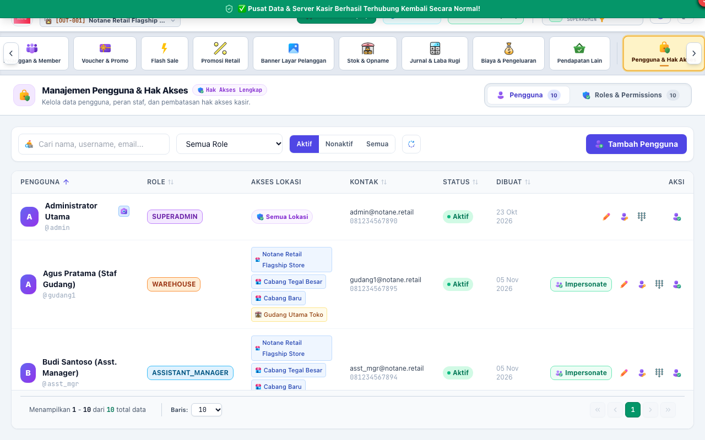

# BAB 10: PANDUAN PENGGUNAAN SUPER ADMINISTRATOR (SUPERADMIN)
**System Administration, RBAC Matrix & Enterprise Configuration**

Peran **SUPERADMIN** memegang kendali tertinggi atas konfigurasi teknis, manajemen akun staf, matriks hak akses perizinan (*Role-Based Access Control*), dan pengaturan parameter global bisnis retail.

---

## 1. MANAJEMEN AKUN PENGGUNA & PENUGASAN CABANG

Superadmin berhak menambah akun staf baru, menentukan penugasan cabang gerai toko (*Outlet Assignment*), dan mengatur status keaktifan akun.

### Elemen Manajemen Pengguna yang Ditandai:
1. **[1] Tombol Tambah Pengguna Baru:** Membuka formulir pendaftaran staf baru.
2. **[2] Filter Peran (*Role Filter*):** Menyaring daftar staf berdasarkan peran tugasnya.
3. **[3] Mode Impersonate (Masuk Sementara):** Fitur diagnostik khusus Superadmin untuk login sementara ke akun staf lain tanpa mengetahui kata sandinya, berguna untuk memvalidasi kendala tampilan yang dialami oleh staf tertentu.

### Langkah Menambahkan Staf Baru:
1. Klik tombol **"Tambah Pengguna"**.
2. Masukkan identitas staf: Nama Lengkap, Username unik, Email, dan Nomor Telepon.
3. Masukkan Kata Sandi login dan PIN otorisasi 6-digit.
4. Pilih **Peran (Role)** yang sesuai dengan deskripsi tugasnya (misal: `CASHIER`, `SUPERVISOR`, `WAREHOUSE`).
5. Centang **Outlet yang Dapat Diakses** (kasir hanya boleh mengakses gerai tempatnya bertugas, sedangkan staf audit dapat mengakses seluruh cabang).
6. Klik **"Simpan Pengguna"**.

---

## 2. PENGATURAN MATRIKS HAK AKSES PERAN (RBAC PERMISSIONS MATRIX)

Notane Retail menerapkan arsitektur perizinan granular di mana setiap tombol, aksi, dan menu dapat diaktifkan atau dinonaktifkan per peran secara mandiri.

### Prosedur Mengatur Hak Akses:
1. Masuk ke tab **[2] Roles & Permissions**.
2. Pilih peran yang ingin disesuaikan (misal: `CASHIER` atau `SUPERVISOR`).
3. Modul perizinan dikelompokkan secara rapi:
   - *Kasir & Transaksi POS* (`pos:*`, `sales:*`)
   - *Retur Penjualan Konsumen* (`sales_returns:*`)
   - *Manajemen Shift Kasir* (`shift:*`)
   - *Stok & Inventori* (`inventory:*`)
   - *Pembelian & Pengadaan* (`purchasing:*`)
   - *Pengeluaran & Biaya Operasional* (`expenses:*`)
   - *Akuntansi & Jurnal* (`accounting:*`)
4. Centang atau hilangkan centang pada hak akses yang diinginkan.
5. Klik tombol **[2] "Simpan Hak Akses Peran"**. Seluruh pengguna dengan peran tersebut akan langsung terikat dengan matriks hak akses baru tanpa perlu restart server.

---

## 3. PENGATURAN PARAMETER RETAIL & FORMAT STRUK BELANJA

Superadmin mengonfigurasi format struk dan kebijakan perhitungan belanja kasir:
1. **Pengaturan Desain Struk (`/admin/receipt-settings`):**
   - Menentukan lebar kertas printer thermal (58mm atau 80mm).
   - Mengatur header struk (nama toko, alamat cabang, nomor telepon, NPWP).
   - Mengatur footer struk (pesan terima kasih, kebijakan retur barang maksimal 1x24 jam dengan membawa struk, akun Instagram toko).
   - Pengaturan cetak logo toko pada printer thermal.
2. **Parameter Retail (`/admin/parameters`):**
   - Kebijakan tarif Pajak Pertambahan Nilai (PPN 11% atau 12%).
   - Kebijakan pembulatan kembalian kasir (*Rounding Rules*, misal: pembulatan Rp 100 ke bawah atau ke atas).
   - Kebijakan batas maksimal diskon manual kasir tanpa persetujuan pimpinan.
