# PANDUAN LENGKAP FITUR SISTEM BERDASARKAN MENU APLIKASI
**Kamus Fitur Terpadu Notane Retail POS & Back-Office Enterprise**

Dokumen ini memuat panduan komprehensif mengenai **seluruh fitur dan kapabilitas sistem** yang diorganisasi secara sistematis berdasarkan struktur navigasi menu yang terdapat pada aplikasi **Notane Retail Client** dan **Notane Retail Server**.

---

## 📑 DAFTAR ISI NAVIGASI MENU

1. [Menu Kasir POS Meja Depan (Front-Desk Point of Sale)](#1-menu-kasir-pos-meja-depan-front-desk-point-of-sale)
2. [Grup Menu Operasional & Master Data Bisnis](#2-grup-menu-operasional--master-data-bisnis)
   - [2.1. Dashboard Hub (`/admin`)](#21-dashboard-hub-admin)
   - [2.2. Statistik & Analisis (`/admin/analytics`)](#22-statistik--analisis-adminanalytics)
   - [2.3. Master Outlet Gerai (`/admin/outlets`)](#23-master-outlet-gerai-adminoutlets)
   - [2.4. Penjualan & Transaksi Kasir (`/admin/sales`)](#24-penjualan--transaksi-kasir-adminsales)
   - [2.5. Shift & Kasir (`/admin/shifts`)](#25-shift--kasir-adminshifts)
   - [2.6. Pembelian & Pengadaan (`/admin/purchases`)](#26-pembelian--pengadaan-adminpurchases)
   - [2.7. Master Produk & Katalog (`/admin/products`)](#27-master-produk--katalog-adminproducts)
   - [2.8. Cetak Label Harga & Barcode Rak (`/admin/price-labels`)](#28-cetak-label-harga--barcode-rak-adminprice-labels)
   - [2.9. Pelanggan & Member Toko (`/admin/customers`)](#29-pelanggan--member-toko-admincustomers)
   - [2.10. Voucher & Kupon Promo (`/admin/vouchers`)](#210-voucher--kupon-promo-adminvouchers)
   - [2.11. Flash Sale Kilat (`/admin/flash-sales`)](#211-flash-sale-kilat-adminflash-sales)
   - [2.12. Promosi Retail & Bundling (`/admin/promotions`)](#212-promosi-retail--bundling-adminpromotions)
   - [2.13. Banner Layar Pelanggan / Customer Display (`/admin/display-banners`)](#213-banner-layar-pelanggan--customer-display-admindisplay-banners)
   - [2.14. Stok & Inventori Opname (`/admin/inventory`)](#214-stok--inventori-opname-admininventory)
   - [2.15. Jurnal & Laba Rugi Akuntansi (`/admin/accounting`)](#215-jurnal--laba-rugi-akuntansi-adminaccounting)
   - [2.16. Biaya & Pengeluaran Operasional (`/admin/expenses`)](#216-biaya--pengeluaran-operasional-adminexpenses)
   - [2.17. Pendapatan Lain-lain (`/admin/other-income`)](#217-pendapatan-lain-lain-adminother-income)
3. [Grup Menu Pengaturan & Keamanan Sistem](#3-grup-menu-pengaturan--keamanan-sistem)
   - [3.1. Pengguna & Hak Akses Peran RBAC (`/admin/users`)](#31-pengguna--hak-akses-peran-rbac-adminusers)
   - [3.2. Desain Struk Belanja, Pembulatan Kas & Pengaturan Pajak (`/admin/receipt-settings`)](#32-desain-struk-belanja-pembulatan-kas--pengaturan-pajak-adminreceipt-settings)
   - [3.3. Parameter Retail & Master Klasifikasi Toko (`/admin/parameters`)](#33-parameter-retail--master-klasifikasi-toko-adminparameters)
   - [3.4. Jejak Audit Keamanan / Audit Logs (`/admin/audit-logs`)](#34-jejak-audit-keamanan--audit-logs-adminaudit-logs)
4. [Fitur Kontrol Notane Retail Server](#4-fitur-kontrol-notane-retail-server)

---

## 1. MENU KASIR POS MEJA DEPAN (FRONT-DESK POINT OF SALE)
*Rute Akses: `/` (Aplikasi Notane Retail POS)*

Menu Kasir adalah antarmuka utama yang digunakan oleh staf kasir untuk melayani pemindaian barang dan pembayaran belanjaan pelanggan secara cepat dan akurat.

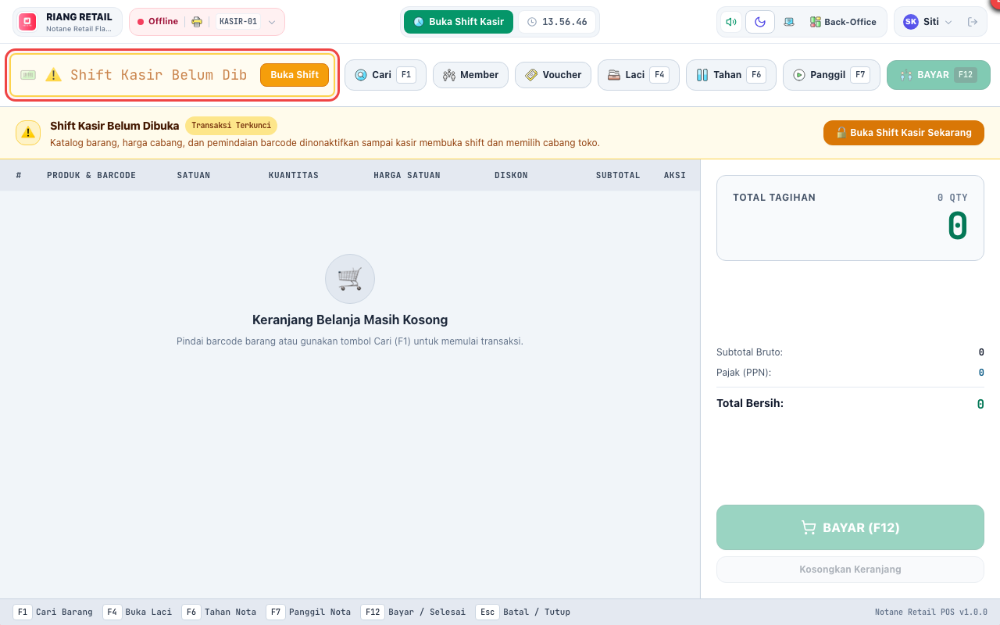

### Rincian Fitur Meja Kasir:
- **Pemindaian Barcode Otomatis & Pencarian Cepat (`F1`):**
  - Mendukung barcode scanner USB, barcode nirkabel Bluetooth, dan input manual keyboard.
  - Mendukung multi-barcode untuk 1 produk (misal: barcode satuan pcs, barcode renceng, dan barcode dus karton).
- **Manajemen Keranjang Belanja:**
  - Tambah kuantitas cepat (cukup scan berulang kali atau klik kolom kuantitas).
  - Hapus item belanja dengan otorisasi supervisor jika nota sudah terkunci.
  - Tampilan subtotal bruto, potongan promosi otomatis, pajak PPN, pembulatan nota, dan total bersih tagihan.
- **Tahan Nota Belanja (`Hold` - `F6`) & Panggil Nota (`Recall` - `F7`):**
  - Menyimpan transaksi sementara jika pembeli ingin mengambil barang tambahan atau uangnya tertinggal di kendaraan, memungkinkan kasir melayani antrean pelanggan berikutnya tanpa membatalkan transaksi.
- **Buka Laci Kasir Manual (`Open Drawer` - `F4`):**
  - Membuka laci kasir secara langsung tanpa adanya transaksi penjualan (wajib otorisasi Supervisor untuk alasan keamanan).
- **Multi-Metode Pembayaran (`Pay` - `F12`):**
  - **Tunai (Cash):** Tombol pecahan nominal cepat (`Rp 50.000`, `Rp 100.000`, `Uang Pas`) dan penghitungan otomatis uang kembalian.
  - **QRIS Dinamis:** Menghasilkan QR Code dinamis langsung di layar untuk pembayaran dompet digital (GoPay, OVO, Dana, ShopeePay, BCA, Livin, dll.).
  - **Mesin EDC:** Pencatatan pembayaran kartu debit dan kredit perbankan beserta nomor referensi transaksi.
- **Buka Shift & Tutup Shift Kasir (*Blind Settlement*):**
  - Kasir mencatat modal uang receh awal saat masuk shift.
  - Di akhir shift, kasir melakukan penghitungan fisik uang tunai di laci secara mandiri (*blind count*) guna mencegah manipulasi kasir sebelum sistem menampilkan selisih kas.
- **Mode Ketahanan Offline (*Offline-First Resilience*):**
  - Jika koneksi kabel LAN atau Wi-Fi ke server terputus sementara, kasir tetap dapat memindai barang dan menyelesaikan transaksi menggunakan *IndexedDB cache* lokal. Transaksi otomatis tersinkronisasi kembali saat jaringan pulih.

---

## 2. GRUP MENU OPERASIONAL & MASTER DATA BISNIS

### 2.1. Dashboard Hub (`/admin`)
*Ikon: `Apps` | Akses: Semua Staf Back-Office*
- Menampilkan ringkasan metrik toko harian: total omzet penjualan hari ini, jumlah transaksi kasir, produk yang stoknya menipis (*Low Stock Warning*), dan status koneksi server toko.
- Menyediakan tombol pintas (*quick shortcuts*) menuju menu-menu yang paling sering dibuka.

---

### 2.2. Statistik & Analisis (`/admin/analytics`)
*Ikon: `Data Pie` | Akses: SUPERADMIN, STORE_MANAGER, SUPERVISOR, ACCOUNTING, INTERNAL_AUDIT*

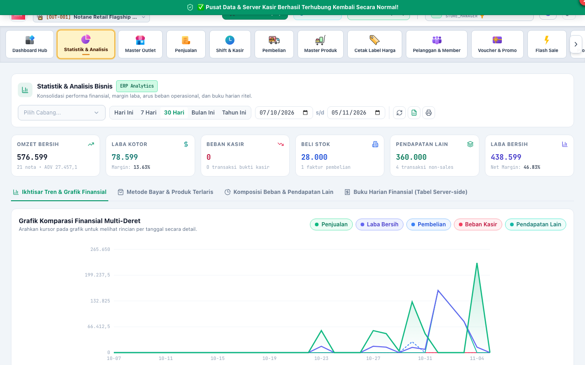

- **Metrik Finansial Konsolidasian:** Menampilkan Omzet Bersih, Laba Kotor (*Gross Profit*), Beban Kas Operasional, Pembelian Stok, Pendapatan Lain-lain, dan Laba Bersih (*Net Profit*).
- **Grafik Komparasi Finansial Multi-Deret:** Visualisasi tren grafik pergerakan penjualan versus laba dan beban operasional toko sepanjang waktu.
- **Analisis Produk Terlaris (*Top 10 Fast-Moving Products*):** Mengetahui produk yang memberikan kontribusi omzet dan perputaran volume tertinggi.
- **Distribusi Metode Pembayaran:** Diagram persentase pembayaran tunai vs QRIS vs kartu debit/kredit EDC.
- **Filter Fleksibel:** Opsi filter data berdasarkan Hari Ini, 7 Hari Terakhir, 30 Hari, Bulan Berjalan, Tahunan, atau pemilihan rentang kalender kustom.
- **Ekspor Laporan:** Tombol unduh ringkasan data analitik langsung ke format lembar kerja Excel (`.xlsx`).

---

### 2.3. Master Outlet Gerai (`/admin/outlets`)
*Ikon: `Building Store` | Akses: SUPERADMIN, STORE_MANAGER*
- **Multi-Gerai Cabang:** Mendaftarkan dan mengelola seluruh cabang toko ritel fisik dan gudang sentral logistik.
- **Data Profil Cabang:** Alamat toko, nomor telepon kontak gerai, konfigurasi gudang bawaan, dan penomoran nota cabang.
- **Pembatasan Hak Akses Wilayah:** Mengatur gerai mana saja yang dapat dibuka oleh staf pengguna tertentu (*User Outlet Access Control*).

---

### 2.4. Penjualan & Transaksi Kasir (`/admin/sales`)
*Ikon: `Receipt` | Akses: SUPERADMIN, STORE_MANAGER, ASSISTANT_MANAGER, SUPERVISOR, ACCOUNTING, INTERNAL_AUDIT*

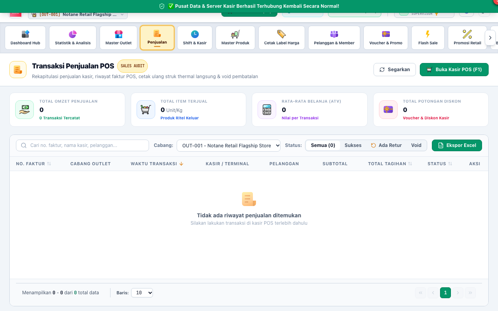

- **Riwayat Transaksi Penjualan Lengkap:** Daftar seluruh nota belanja kasir dengan filter tanggal, kasir yang bertugas, metode pembayaran, dan status transaksi (*PAID* / *VOID*).
- **Rincian Item Nota (*Invoice Detail*):** Melihat daftar barang yang dibeli, harga satuan, diskon promosi per item, pajak PPN, dan identitas kasir yang melayani.
- **Cetak Ulang Struk Kasir (*Reprint Receipt*):** Mencetak kembali salinan struk belanja pelanggan jika struk fisik sebelumnya hilang atau rusak.
- **Otorisasi Void Transaksi Kasir:** Pembatalan nota transaksi dengan pencatatan alasan resmi dari tabel *Reason Codes* dan otomatis menerbitkan Jurnal Pembalik akuntansi (*Reversing Entry*).
- **Modul Retur Penjualan Konsumen (*Sales Returns*):**
  - Menerima permohonan retur penukaran barang dari pembeli.
  - Memverifikasi kondisi fisik barang: apakah barang kembali ke **Stok Baik** (dapat dijual lagi) atau dialokasikan ke **Stok Rusak/Klaim Vendor**.
  - Otorisasi persetujuan retur (*Approval*) atau penolakan retur (*Reject*) oleh Supervisor.
- **Ekspor Riwayat Penjualan ke Excel:** Mengunduh seluruh rincian penjualan per nota maupun per baris produk ke format Excel untuk kebutuhan laporan audit.

---

### 2.5. Shift & Kasir (`/admin/shifts`)
*Ikon: `Clock` | Akses: SUPERADMIN, STORE_MANAGER, ASSISTANT_MANAGER, SUPERVISOR*
- **Pemantauan Shift Kasir Aktif:** Memeriksa nama kasir yang sedang bertugas di meja kasir, waktu mulai shift, dan jumlah kas berjalan.
- **Rekonsiliasi Kas Laci (*Cash Variance Audit*):** Membandingkan nominal fisik yang dihitung kasir saat tutup shift (*Blind Settlement*) dengan hitungan sistem. Jika terjadi selisih (kurang/lebih kas), sistem mencatat deviasi tersebut sebagai catatan pertanggungjawaban kasir.
- **Setor Kas Laci ke Brankas (*Cash Drop*):** Penarikan kelebihan kas laci kasir di tengah shift untuk diamankan ke brankas supervisor guna meminimalisasi risiko keamanan meja kasir.

---

### 2.6. Pembelian & Pengadaan (`/admin/purchases`)
*Ikon: `Delivery Truck` | Akses: SUPERADMIN, STORE_MANAGER, ASSISTANT_MANAGER, PURCHASING, WAREHOUSE*

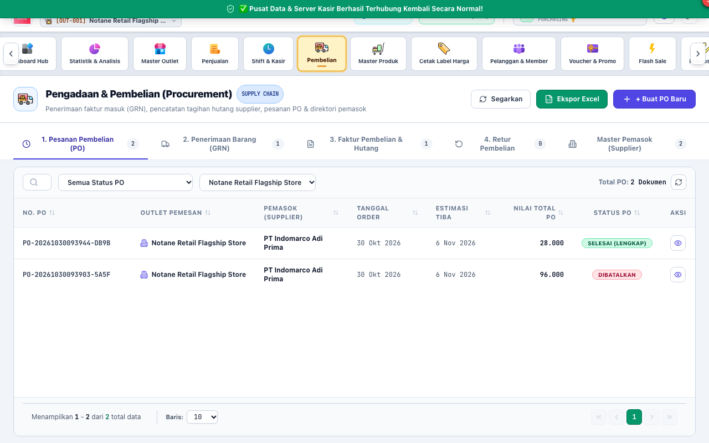

- **Pesanan Pembelian (Purchase Order / PO):** Pembuatan dokumen pesanan resmi ke pemasok, menentukan tanggal perkiraan kirim, termin pembayaran (*COD/Tempo*), dan mengunci harga beli barang.
- **Bukti Penerimaan Barang (Goods Receipt Note / GRN):** Mencatat fisik barang yang diterima di gudang toko, mencatat nomor batch dan tanggal kedaluwarsa (*Expired Date*), serta memverifikasi kesesuaian kuantitas antara surat jalan vendor dengan pesanan PO.
- **Faktur Pembelian Supplier (*Purchase Invoices*):** Menerbitkan faktur utang dagang dari dokumen GRN yang telah diterima, mencatat nomor seri faktur pajak, dan tanggal jatuh tempo tagihan vendor.
- **Pelunasan Utang Dagang (*Accounts Payable Settlement*):** Membayar faktur supplier secara penuh atau cicilan parsial melalui akun kas atau rekening bank usaha toko.
- **Retur Pembelian ke Supplier:** Mengembalikan barang kiriman vendor yang cacat/rusak/kedaluwarsa dengan opsi kompensasi pemotongan saldo utang faktur atau pengembalian dana tunai.

---

### 2.7. Master Produk & Katalog (`/admin/products`)
*Ikon: `Warehouse Cart` | Akses: SUPERADMIN, STORE_MANAGER, ASSISTANT_MANAGER, MERCHANDISER, WAREHOUSE*

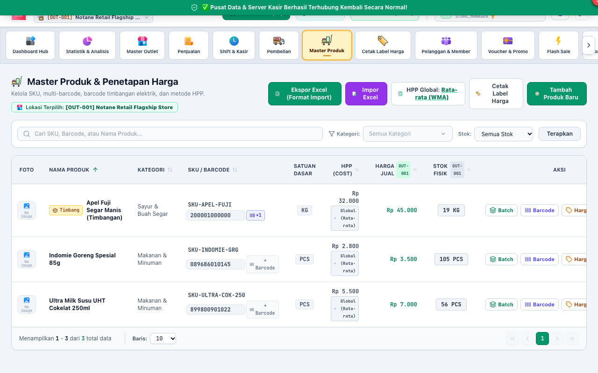

- **Katalog Produk Terpadu:** Manajemen nama produk, kode SKU, kategori klasifikasi, merek manufaktur, dan foto produk beresolusi tinggi.
- **Multi-Satuan & Konversi Takaran:** Mengatur satuan bertingkat (misal: 1 DUS = 24 PCS, atau 1 BOX = 12 PCS) dan mendukung satuan desimal/timbangan kilogram (`KG`).
- **Multi-Barcode per Produk:** 1 produk dapat memiliki beberapa kode barcode sekaligus (misal barcode pabrik kemasan lama, barcode kemasan baru, dan barcode stiker internal toko).
- **Pengaturan Multi-Harga Outlet:** Mengatur harga jual yang berbeda-beda untuk setiap cabang outlet toko retail.
- **Harga Khusus Member & Grup Pelanggan:** Menetapkan harga spesial untuk pelanggan VIP, Member Grosir, atau Pelanggan Warung.
- **Harga Grosir Bertingkat (*Price Tiers*):** Mengatur potongan harga otomatis jika membeli dalam kuantitas tertentu (misal: beli 1 pcs = Rp 10.000, beli >= 10 pcs = Rp 9.200/pcs).
- **Pelacakan Batch & Kedaluwarsa (*FEFO Tracking*):** Memantau tanggal kedaluwarsa per kelompok barang masuk untuk memprioritaskan penjualan barang yang lebih awal kedaluwarsa.
- **Impor & Ekspor Masal Excel:** Mengimpor ribuan katalog produk baru beserta harga beli dan harga jual menggunakan template Excel standar dalam hitungan detik.

---

### 2.8. Cetak Label Harga & Barcode Rak (`/admin/price-labels`)
*Ikon: `Tags` | Akses: SUPERADMIN, STORE_MANAGER, ASSISTANT_MANAGER, WAREHOUSE, MERCHANDISER*

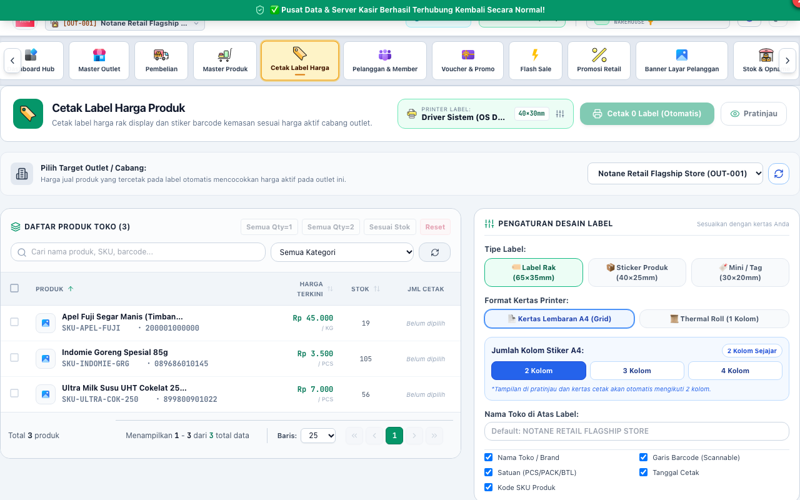

- **Pencetakan Label Rak Toko (*Shelf Price Tags*):** Mencetak label informasi harga jual, nama barang, kode SKU, dan barcode produk untuk ditempelkan pada rak pajang toko (*gondola display*).
- **Dukungan Format Kertas Fleksibel:** Format kertas stiker thermal mini, format barcode barcode standar 3-kolom, atau lembar A4 label tempel.
- **Cetak Massal Produk Berubah Harga:** Memfilter seluruh produk yang baru saja mengalami pembaruan harga jual sehingga staf toko dapat langsung mencetak label rak baru tanpa mencari satu per satu.

---

### 2.9. Pelanggan & Member Toko (`/admin/customers`)
*Ikon: `People Team` | Akses: SUPERADMIN, STORE_MANAGER, ASSISTANT_MANAGER, MERCHANDISER*
- **Database Profil Pelanggan:** Menyimpan data nama, nomor WhatsApp/telepon, alamat email, alamat pengiriman, dan tanggal ulang tahun member.
- **Grup Klasifikasi Member:** Mengelompokkan pelanggan ke dalam level member (misal: *Reguler*, *Silver*, *Gold*, *Platinum VIP*).
- **Batas Kredit Piutang (*Credit Limit*):** Mengatur pagu maksimal utang belanja yang diizinkan untuk pelanggan langganan atau rekanan bisnis beserta tanggal jatuh tempo pembayaran.
- **Program Loyalitas Poin Belanja:** Setiap kelipatan nilai belanja tertentu otomatis dikonversi menjadi poin loyalitas member yang dapat ditukarkan (*redeem*) menjadi potongan harga saat checkout di kasir.

---

### 2.10. Voucher & Kupon Promo (`/admin/vouchers`)
*Ikon: `Gift Card` | Akses: SUPERADMIN, STORE_MANAGER, ASSISTANT_MANAGER, MERCHANDISER*
- **Pembuatan Kode Kupon Promo:** Menentukan kode voucher unik toko (misal: `HEMAT50K`, `DISCONMEMBER`, `HARBOLNAS`).
- **Aturan Diskon:** Potongan diskon berupa persentase (%) atau nominal rupiah tetap (Rp) dengan syarat minimal nominal total belanja nota.
- **Alokasi Kuota Klaim:** Membatasi kuota maksimal penggunaan voucher (misal: hanya untuk 200 pembeli pertama).
- **Validasi Waktu:** Mengatur tanggal mulai berlaku dan batas akhir kedaluwarsa kupon.

---

### 2.11. Flash Sale Kilat (`/admin/flash-sales`)
*Ikon: `Flash On` | Akses: SUPERADMIN, STORE_MANAGER, MERCHANDISER*
- **Promosi Jam Tertentu:** Menjadwalkan promosi potongan harga khusus pada jam-jam tertentu (misal: *Flash Sale Malam Minggu pukul 19.00 - 21.00*).
- **Batas Maksimal Pembelian Per Pelanggan:** Membatasi agar setiap nota transaksi kasir hanya boleh membeli maksimal X unit barang promo untuk mencegah aksi borong pedagang/tengkulak.
- **Hitung Mundur (*Countdown Timer*):** Menampilkan banner hitung mundur promosi di layar kasir dan banner pelanggan.

---

### 2.12. Promosi Retail & Bundling (`/admin/promotions`)
*Ikon: `Discount` | Akses: SUPERADMIN, STORE_MANAGER, ASSISTANT_MANAGER, MERCHANDISER*

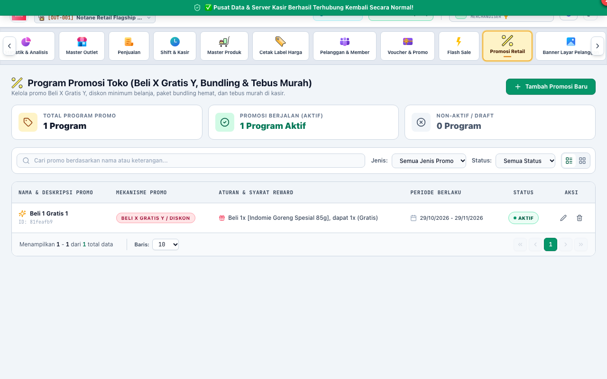

- **Skema Beli X Gratis Y (*Buy 1 Get 1 Free*):** Memberikan produk hadiah gratis saat membeli produk tertentu (misal: beli 2 susu kotak gratis 1 biskuit).
- **Diskon Paket Bundling (*Combo Packages*):** Menetapkan harga paket hemat untuk pembelian kombinasi beberapa produk sekaligus (misal: Paket Sarapan = Roti + Selai + Mentega = Rp 25.000).
- **Diskon Khusus Hari Tertentu:** Mengaktifkan diskon otomatis hanya pada hari Jumat-Minggu (*Promo JSM - Jumat Sabtu Minggu*).

---

### 2.13. Banner Layar Pelanggan / Customer Display (`/admin/display-banners`)
*Ikon: `Image` | Akses: SUPERADMIN, STORE_MANAGER, ASSISTANT_MANAGER, MERCHANDISER*

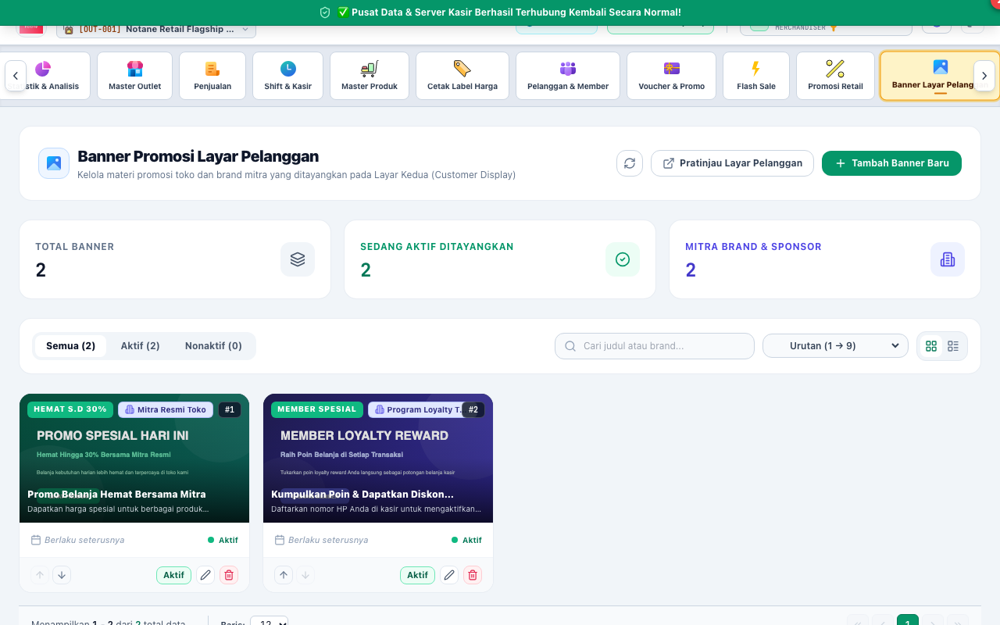

- **Pusat Pengelolaan Layar Kedua Kasir (*Customer Facing Screen*):** Mengunggah media promosi visual yang ditampilkan pada monitor kedua yang menghadap ke arah pembeli di meja kasir.
- **Rotasi Slide Promosi (*Slideshow Carousel*):** Menampilkan gambar bergantian dengan durasi transisi yang dapat disesuaikan saat kasir tidak sedang memindai belanjaan.
- **Tampilan Struk Belanja Real-Time:** Saat kasir mulai memindai barcode, layar pelanggan otomatis beralih menampilkan daftar barang belanjaan, harga, dan total belanja secara transparan kepada konsumen.

---

### 2.14. Stok & Inventori Opname (`/admin/inventory`)
*Ikon: `Warehouse Storage` | Akses: SUPERADMIN, STORE_MANAGER, ASSISTANT_MANAGER, WAREHOUSE, SUPERVISOR*

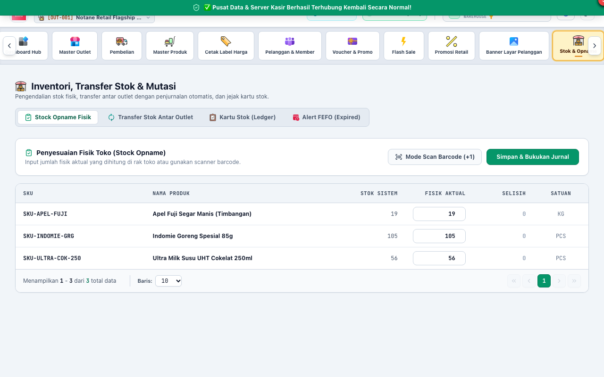

- **Status Stok Real-Time:** Menampilkan jumlah stok fisik, stok dalam pesanan PO (*On-Order*), dan stok dalam perjalanan antar-cabang (*In-Transit*).
- **Kartu Stok Buku Pembantu:** Melacak kronologi mutasi setiap unit barang (tanggal, nomor faktur/nota, jenis mutasi masuk/keluar, saldo akhir, dan nama pengguna pelaksana).
- **Stock Opname Fisik Toko:** Formulir input penghitungan fisik periodik (harian, mingguan, bulanan) dengan perhitungan otomatis nilai selisih barang dan beban penyusutan (*shrinkage*).
- **Mutasi Transfer Stok Antar Outlet:** Mengirim dan menerima perpindahan persediaan antar toko ritel secara akurat dengan dokumen Surat Jalan resmi.

---

### 2.15. Jurnal & Laba Rugi Akuntansi (`/admin/accounting`)
*Ikon: `Accounting Calculator` | Akses: SUPERADMIN, STORE_MANAGER, ACCOUNTING*

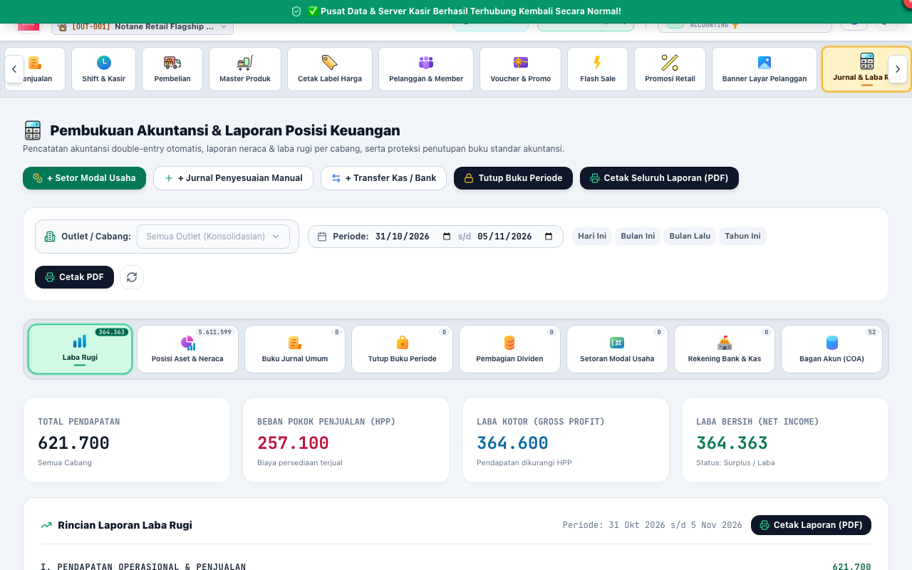

- **Bagan Akun Standar (*Chart of Accounts / COA*):** Struktur akun akuntansi lengkap ritel modern (Aktiva Lancar, Aktiva Tetap, Utang Lancar, Utang Jangka Panjang, Ekuitas Modal, Pendapatan Penjualan, Pendapatan Lain, HPP, Beban Operasional, dan Pajak).
- **Buku Jurnal Umum (*General Journal*):** Menampilkan seluruh baris jurnal otomatis yang dihasilkan dari transaksi kasir POS, faktur pembelian, biaya kas, dan retur.
- **Entri Jurnal Penyesuaian Manual:** Fasilitas input jurnal manual berpasangan (*Double-Entry*) dengan penegakan validasi keseimbangan debit sama dengan kredit (`Total Debit == Total Credit`).
- **Laporan Laba Rugi Komprehensif (*Income Statement*):** Menampilkan perolehan pendapatan bersih, beban pokok penjualan barang (HPP), laba kotor, seluruh pos beban operasional gerai, pendapatan lain, dan laba bersih usaha (*Net Income*).
- **Neraca Saldo & Posisi Keuangan (*Balance Sheet*):** Menampilkan keseimbangan nilai aset toko dengan jumlah total kewajiban utang dan modal pemilik.
- **Setoran & Penarikan Modal Pemilik (*Capital Management*):** Mencatat penambahan modal disetor oleh pemilik usaha atau penarikan prive ke rekening kas/bank.
- **Rekening Kas & Bank Usaha:** Mengelola daftar rekening perbankan toko, memantau saldo mutasi masuk dan keluar, serta rekonsiliasi bank.
- **Rekening Antar Kantor (*RAK / Inter-branch Fund Transfer*):** Mencatat transfer dana kas antar kantor cabang toko secara otomatis berimbang.
- **Pembagian Dividen Usaha:** Mencatat penetapan dan pencairan pembagian dividen dari laba bersih periode yang telah ditutup kepada para pemegang saham/pemilik.
- **Penutupan Periode Akuntansi (*Soft-Close & Hard-Close*):** Mengunci tanggal transaksi agar tidak dapat diubah-ubah setelah laporan bulanan atau tahunan disahkan.

---

### 2.16. Biaya & Pengeluaran Operasional (`/admin/expenses`)
*Ikon: `Money Bag` | Akses: SUPERADMIN, STORE_MANAGER, ASSISTANT_MANAGER, ACCOUNTING, SUPERVISOR*

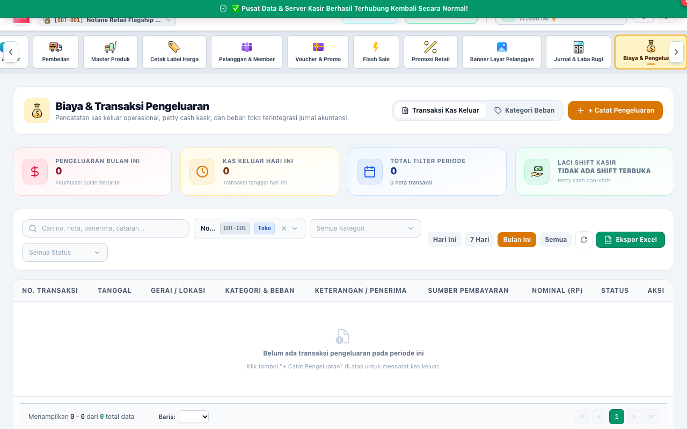

- **Pencatatan Beban Harian Toko:** Mencatat pengeluaran kas operasional gerai (misal: token listrik PLN, tagihan air PDAM, pembelian plastik kresek kasir, bensin operasional toko, dan konsumsi lembur staf).
- **Master Kategori Beban:** Mengelompokkan pos pengeluaran menjadi pos biaya yang teratur sesuai standar akuntansi ritel.
- **Sumber Rekening Kasir / Bank:** Memilih apakah uang diambil dari kas kecil laci kasir (*Petty Cash*) atau ditransfer dari rekening bank utama toko.
- **Bukti Lampiran & Catatan Nota:** Menyimpan nomor bukti nota fisik dan keterangan kebutuhan operasional untuk kebutuhan audit keuangan.

---

### 2.17. Pendapatan Lain-lain (`/admin/other-income`)
*Ikon: `Paid` | Akses: SUPERADMIN, STORE_MANAGER, ASSISTANT_MANAGER, ACCOUNTING*
- **Pencatatan Pemasukan Non-Retail:** Mencatat aliran dana masuk di luar penjualan kasir reguler (misal: pendapatan sewa rak display promosi dari supplier, komisi agen ekspedisi/top-up, fee konsinyasi, atau penjualan kardus dan jeriken bekas gudang).
- **Alokasi Kas Masuk:** Menghubungkan penerimaan dana langsung ke akun kas kasir atau rekening bank usaha toko.
- **Jurnal Otomatis:** Membukukan akun debit Kas/Bank dan kredit Pendapatan Lain-lain secara otomatis.

---

## 3. GRUP MENU PENGATURAN & KEAMANAN SISTEM

### 3.1. Pengguna & Hak Akses Peran RBAC (`/admin/users`)
*Ikon: `Lock Shield` | Akses: SUPERADMIN, STORE_MANAGER*

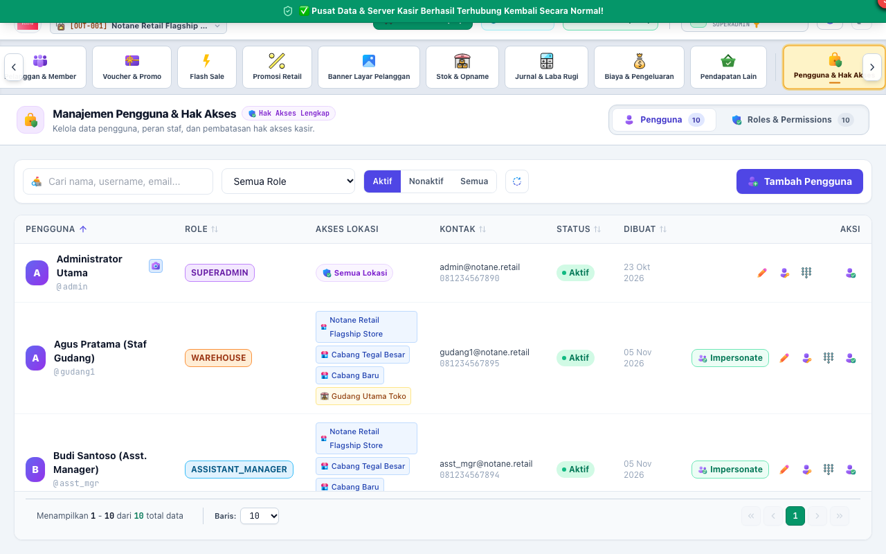

- **Manajemen Akun Staf Toko:** Mendaftarkan staf baru, mengubah nama lengkap, email, nomor HP, peran penugasan, dan status keaktifan akun.
- **Penugasan Outlet Cabang (*Store Assignment*):** Membatasi gerai cabang mana saja yang dapat dibuka oleh akun staf tersebut saat login.
- **Reset PIN & Kata Sandi:** Mengubah atau mereset nomor PIN otorisasi transaksi kasir (6 digit) atau kata sandi akun staf.
- **Mode Impersonate Diagnostik:** Superadmin dapat masuk sementara menggunakan profil staf lain untuk melihat tampilan sistem persis seperti yang dilihat oleh kasir/gudang tanpa memerlukan password staf tersebut.
- **Matriks Hak Akses Peran Granular (*Roles & Permissions Matrix*):**
  - Mengatur matriks perizinan untuk 10 peran standar retail (`SUPERADMIN`, `STORE_MANAGER`, `ASSISTANT_MANAGER`, `SUPERVISOR`, `CASHIER`, `WAREHOUSE`, `PURCHASING`, `ACCOUNTING`, `INTERNAL_AUDIT`, `MERCHANDISER`).
  - Mengaktifkan atau menonaktifkan izin spesifik (misal: membatasi kasir agar tidak bisa melihat laporan laba rugi atau mencabut hak ekspor data).

---

### 3.2. Desain Struk Belanja, Pembulatan Kas & Pengaturan Pajak (`/admin/receipt-settings`)
*Ikon: `Document Text` | Akses: SUPERADMIN, STORE_MANAGER*

Menu ini merupakan pusat pengaturan terpadu untuk format cetak struk thermal kasir, profil identitas toko, metode pembulatan uang kembalian kasir, serta kebijakan dan tarif Pajak Pertambahan Nilai (PPN):

- **1. Profil & Identitas Toko (Tab 1):**
  - **Nama Toko / Unit Usaha:** Dicetak paling atas pada struk dengan format teks tebal (*Bold & Double Height*).
  - **Slogan / Tagline Usaha:** Memperkuat citra brand gerai ritel tepat di bawah nama toko.
  - **Alamat Lengkap Toko / Outlet:** Otomatis dibungkus (*word-wrap*) sesuai batas kolom kertas thermal.
  - **Kontak & Website:** Nomor telepon/WhatsApp kasir dan alamat situs online toko.
  - **NPWP / Tax ID Toko:** Nomor Pokok Wajib Pajak untuk dicetak pada header struk kasir (bagi toko PKP).

- **2. Pesan Header & Footer (Tab 2):**
  - **Catatan Pembuka (*Header Note*):** Teks salam pembuka (misal: *"Selamat Datang & Selamat Berbelanja"*).
  - **Ketentuan Transaksi (*Footer Note 1*):** Kebijakan retur barang (misal: *"Barang yang sudah dibeli tidak dapat ditukar/dikembalikan"*).
  - **Layanan Pelanggan (*Footer Note 2*):** Kontak saluran kritik, saran, atau aduan konsumen.
  - **Media Sosial:** Akun promosi Instagram atau TikTok toko.

- **3. Format Cetak & Kertas Thermal (Tab 3):**
  - **Standar Lebar Kertas Thermal Toko:** Memilih ukuran standar kertas **58mm** (lebar 32 kolom karakter) atau ukuran supermarket **80mm** (lebar 48 kolom karakter).
  - **Visibilitas Elemen Struk:** Toggle untuk menampilkan/menyembunyikan alamat toko, nomor telepon, nama kasir bertugas, barcode faktur transaksi, rincian diskon Flash Sale, rincian diskon member, rincian pajak (PPN), dan banner ucapan total penghematan pelanggan (*"ANDA TELAH HEMAT Rp ..."*).
  - **Uji Cetak Thermal Langsung:** Tombol *"Uji Cetak Thermal"* untuk mengirimkan contoh struk pengujian langsung ke hardware printer kasir yang sedang terhubung.

- **4. Kebijakan Pembulatan Pecahan Kas & Limit Laci Kasir (Tab 4):**
  - **Metode Pembulatan Kas Tunai (*Cash Rounding Mode*):**
    - *Tidak Ada Pembulatan (NONE):* Perhitungan kembalian kasir dihitung presisi sampai pecahan Rupiah asli (Rp 1,-).
    - *Bulatkan ke Bawah ke Rp 100 Terdekat (ROUND_100_DOWN):* Menguntungkan konsumen (contoh: Total Rp 15.340 dibulatkan menjadi Rp 15.300, toko memberikan diskon selisih Rp 40).
    - *Bulatkan ke Bawah ke Rp 500 Terdekat (ROUND_500_DOWN):* Memudahkan kembalian pecahan koin (contoh: Total Rp 15.750 dibulatkan menjadi Rp 15.500).
    - *Bulatkan ke Atas ke Rp 100 Terdekat (ROUND_100_UP):* Penyesuaian kasir ke atas (contoh: Total Rp 15.340 dibulatkan menjadi Rp 15.400).
    - *Bulatkan ke Atas ke Rp 500 Terdekat (ROUND_500_UP):* Penyesuaian kasir ke pecahan Rp 500 berikutnya.
    - *Opsi Donasi Receh Kasir (DONATION_ROUND):* Kasir dapat menawarkan penyaluran sisa uang kembalian receh ke Dana Sosial / Donasi Konsumen (tercatat resmi pada akun akuntansi Titipan Donasi Konsumen COA 2104).
  - **Ambang Batas Maksimal Uang Fisik di Laci Kasir (*Max Cash Drawer Limit*):** Menetapkan limit nominal uang kas laci (misal Rp 2.000.000,-). Ketika kas laci melampaui limit ini, kasir otomatis diperingatkan untuk melakukan **Setor Kas Laci (Cash Drop)** ke brankas/supervisor demi keamanan gerai.

- **5. Kebijakan & Tarif Pajak Toko / PPN (Tab 5):**
  - **Status Pemungutan PPN Toko:** Mengaktifkan atau menonaktifkan pemungutan PPN. Jika toko berstatus non-PKP / bebas pajak, opsi ini dimatikan sehingga perhitungan pajak di kasir otomatis menjadi Rp 0.
  - **Tarif Pajak PPN Standar (%):** Menetapkan besaran persentase tarif PPN toko dengan tombol preset instan (**11%** Standar Saat Ini, **12%** Regulasi UU HPP, atau **0%** Bebas PPN).
  - **Harga Katalog Termasuk PPN (Pajak Inklusif):** Menentukan apakah harga jual di rak kasir sudah bersih termasuk pajak (*Tax-Inclusive*) atau pajak baru ditambahkan di atas subtotal saat checkout (*Tax-Exclusive*).
  - **Tampilkan Rincian Pajak (PPN) pada Struk Thermal:** Mengatur pencetakan baris ringkasan nilai PPN pada struk kertas pelanggan.

---

### 3.3. Parameter Retail & Master Klasifikasi Toko (`/admin/parameters`)
*Ikon: `Settings` | Akses: SUPERADMIN, STORE_MANAGER*

Menu ini mengelola master klasifikasi operasional barang dagang, rekanan pemasok, metode akuntansi persediaan, dan keamanan perangkat keras biometrik:

- **1. Satuan Produk (*Units* - Tab 1):** Mengelola unit satuan ukuran barang (misal: `PCS`, `PACK`, `BOX`, `DUS`, `KG`, `LTR`, `IKAT`) beserta penanda apakah satuan mendukung bilangan desimal/pecahan (*is_fractional* untuk produk timbangan buah/sayur).
- **2. Kategori Produk (*Categories* - Tab 2):** Struktur hierarki pengelompokan jenis barang (misal: *Makanan Ringan*, *Minuman Dingin*, *Sembako*, *Perlengkapan Mandi*) dengan dukungan sub-kategori bertingkat (*Parent-Child Category*).
- **3. Merek Produk (*Brands* - Tab 3):** Master data nama brand atau prinsipal produsen barang ritel untuk pelaporan omzet per merek.
- **4. Pemasok & Vendor (*Suppliers* - Tab 4):** Database pemasok barang dagang gerai, mencakup kode supplier, nama perusahaan, narahubung (*contact person*), nomor WhatsApp, alamat kantor, dan termin jatuh tempo pembayaran (*Term of Payment / TOP* dalam hitungan hari).
- **5. Metode Penilaian Biaya Persediaan / HPP (*Costing Method* - Tab 5):**
  - *FIFO (First In, First Out):* Menetapkan harga pokok penjualan berdasarkan batch stok barang yang masuk paling awal.
  - *Moving Average (WMA):* Menghitung nilai HPP persediaan berdasarkan rata-rata tertimbang harga beli setiap kali terjadi penerimaan barang baru.
- **6. Konfigurasi Biometrik & Keamanan Supervisor (Tab 6):**
  - *Mode Biometrik:* Pilihan integrasi sensor sidik jari (*fingerprint USB*) atau kamera pengenal wajah (*face recognition camera*) untuk supervisor toko.
  - *Kebijakan Otorisasi Supervisor:* Mengatur apakah otorisasi pembatalan nota (void), diskon manual, dan retur wajib menggunakan biometrik (*MANDATORY*), opsional dengan PIN (*OPTIONAL*), atau PIN biasa (*OFF*).
  - *Ambang Batas Pencocokan Wajah (*Face Match Threshold*):* Menentukan skor akurasi minimal (default 75%) untuk persetujuan pengenalan wajah.
- **7. Direktori Penyimpanan & Backup (Tab 7):** Mengonfigurasi lokasi folder lokal pada komputer server tempat file arsip cadangan basis data (*database backup*) dan dokumen ekspor disimpan secara aman.

---

### 3.4. Jejak Audit Keamanan / Audit Logs (`/admin/audit-logs`)
*Ikon: `Shield Checkmark` | Akses: SUPERADMIN, INTERNAL_AUDIT*

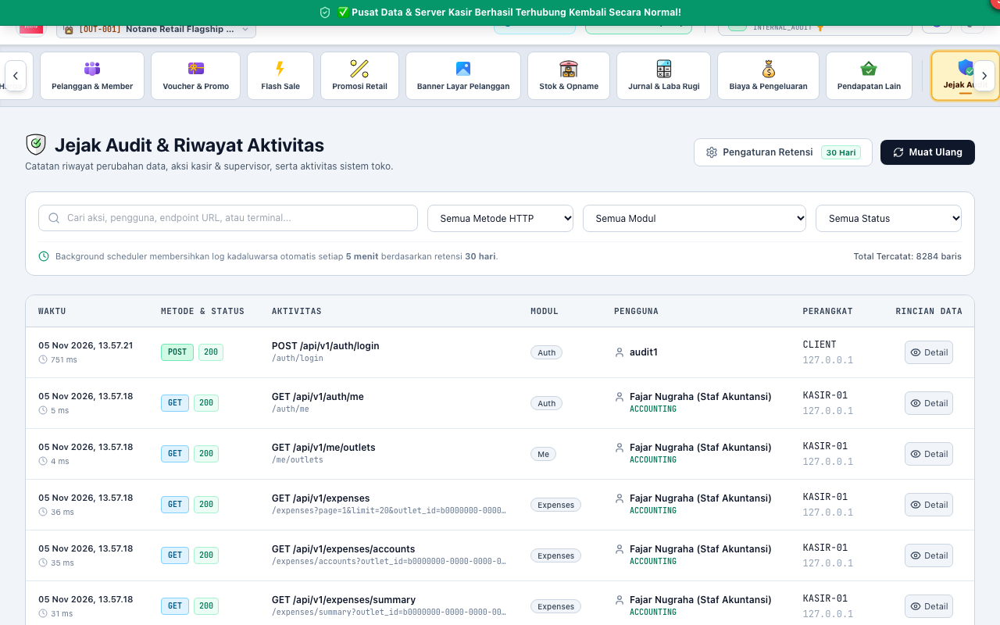

- **Rekaman Jejak Aktivitas (*Audit Trail*):** Menyimpan catatan kronologis tidak terhapus (*immutable*) atas setiap operasi perubahan data di seluruh sistem.
- **Detail Jejak Audit:** Mencatat waktu presisi (timestamp), nama staf pengguna, peran, alamat IP terminal komputer, modul yang diakses, tipe aksi (*CREATE / UPDATE / VOID / DELETE*), serta rekaman perbandingan nilai data sebelum dan sesudah diubah.
- **Kebijakan Retensi Log Keamanan:** Mengatur batas masa simpan arsip log audit (misal: 1 tahun, 3 tahun, atau permanen).

---

## 4. FITUR KONTROL NOTANE RETAIL SERVER
*Akses: Melalui Aplikasi Notane Retail Server di Komputer Server Toko*

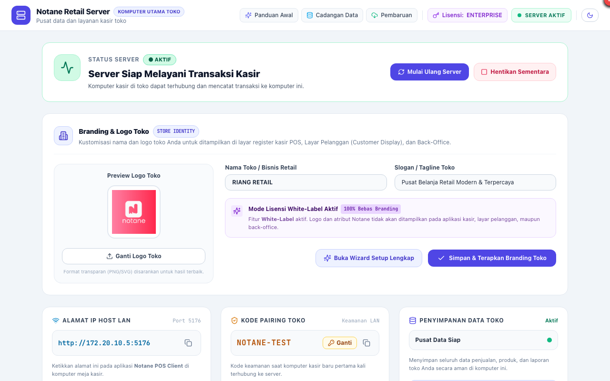

- **Layanan Mesin Server (*Server Daemon Controls*):**
  - **Mulai Ulang Server (`Restart`):** Memuat ulang mesin HTTP dan koneksi basis data secara aman tanpa merusak data antrean.
  - **Hentikan Sementara (`Pause/Stop`):** Menghentikan sementara penerimaan transaksi baru dari kasir saat dilakukan pemeliharaan fisik komputer.
- **Alamat IP Host LAN & Port Jaringan:** Menampilkan alamat IP lokal komputer server (misal: `http://192.168.1.24:18080`) untuk dimasukkan pada komputer kasir meja depan.
- **Kode Pairing Keamanan (*Pairing Code*):** Mengatur kode otentikasi unik (misal: `NOTANE-TEST`) yang wajib dimasukkan oleh kasir baru saat pertama kali menghubungkan komputer kasir ke server toko.
- **Pencadangan Basis Data (*Database Backup*):** Mengekspor seluruh basis data PostgreSQL dan manifest kompatibilitas versi ke dalam satu file berkas terkompresi ZIP terenkripsi.
- **Pemulihan Basis Data (*Disaster Recovery Restore*):** Memulihkan data toko secara utuh dari file cadangan ZIP saat terjadi pergantian komputer atau pemulihan bencana.
- **Personalisasi Identitas Toko (*White-Label Branding*):** Mengatur nama bisnis retail resmi, slogan toko, dan mengunggah logo utama toko yang otomatis disinkronkan ke seluruh kasir dan layar display pelanggan.
- **Pembaruan Sistem Otomatis (*One-Click OTA Update*):** Memeriksa ketersediaan rilis versi software terbaru langsung ke server lisensi resmi Notane (`https://lisensi.notane.id`), mengunduh paket pembaruan, dan menerapkan instalasi secara otomatis tanpa perlu setup ulang.

